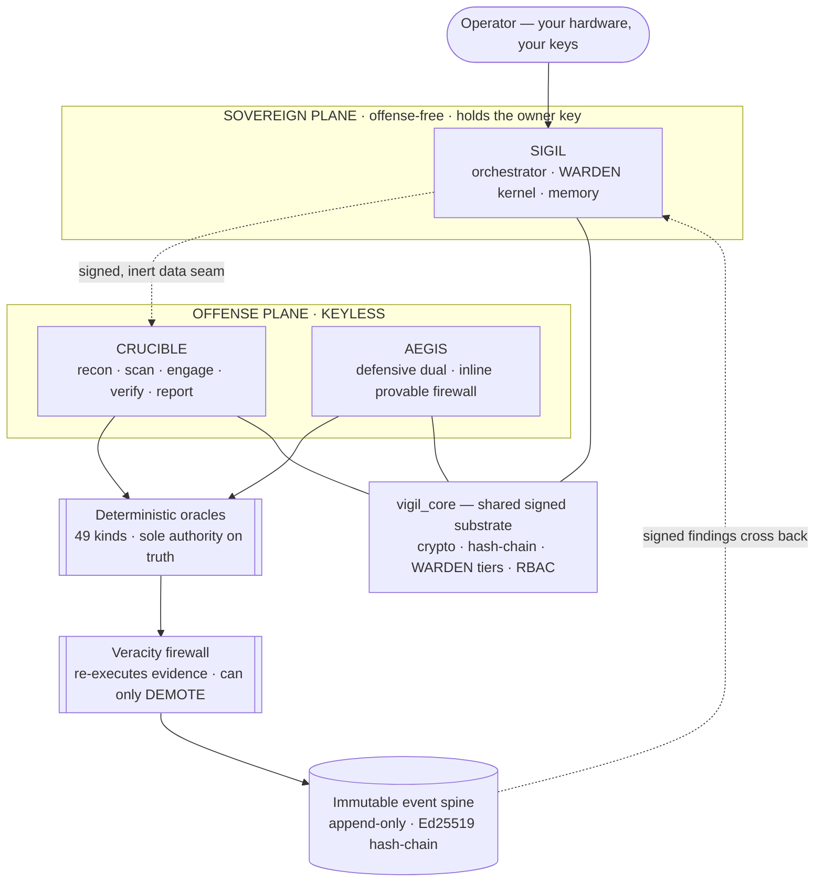
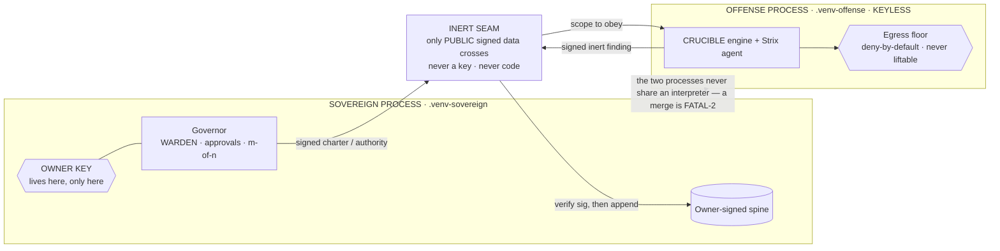
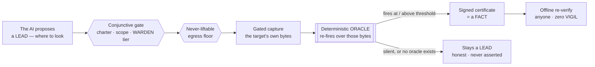
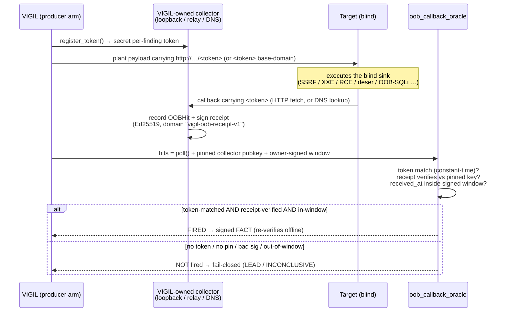

<div align="center">

# 🛡️ VIGIL

# The Provable Adversary

### Provable offensive **and** defensive security — an autonomous adversary that doesn't ask you to trust it.

**Proof, not findings.**

VIGIL is an autonomous security platform that hunts real vulnerabilities in systems you're authorized to test — and **proves every single one.** A finding only becomes a fact when a plain, non-AI program called an **oracle** re-runs a real test over the *target's own bytes*; the result is cryptographically **signed** and **re-checkable offline by anyone**, with no VIGIL and no vendor required. It governs its own autonomy behind fail-closed cryptographic gates — on hardware you own, under keys you hold.

### 📖 [Read the manifesto → *The Provable Adversary*](docs/MANIFESTO.md)

### 🖼️ [Browse the UI screenshots →](docs/screenshots/)

*A visual walkthrough — every screen end-to-end, live oracle-proven findings, the interaction-driven UI, and the SIGIL sovereign voice.*

<sub>offensive security · penetration testing · red team · bug bounty · ethical hacking · cybersecurity · infosec · security research · AI security · LLM security · agentic AI · autonomous security agent · AppSec · web security · API security · vulnerability scanner · DAST · provable security · verifiable security · oracle-confirmed findings · tamper-evident evidence · cryptographic attestation · Ed25519 · offline-verifiable proofs · zero-trust · defensive security · AEGIS · CRUCIBLE · SIGIL · sovereign AI</sub>

</div>

---

## The 60-second version

**What it does.** Point VIGIL at an authorized target and it does what a sharp human red-teamer does — crawls the attack surface, reasons about it, forms hypotheses, fires payloads, and chains bugs into attack paths — across web, API, authentication, authorization, injection, client-side, business-logic, crypto, network, cloud / container / Kubernetes / service-mesh, CI/CD, supply-chain, mobile, LLM, SSO, and static source code. It knows **110 canonical vulnerability classes** (plus 285 alias spellings), and **62 of its 84 evidence branches can mint a cryptographically signed *fact*** through one of **49 purpose-built oracles**. Every proven class is mapped to the standards an auditor asks for — **OWASP Top 10:2021, CWE, MITRE ATT&CK / ATLAS, NIST CSF 2.0, MITRE D3FEND, OCSF, NIST SSDF, PCI DSS v4, SOC 2, ISO/IEC 27001:2022**. When you patch, it re-fires *the same oracle* over fresh bytes to prove the fix — or prove it's still broken. And it is also a **defensive** engine (**AEGIS**) and a sovereign personal assistant (**SIGIL**) over the same honest core.

**The one idea — proof, not findings.** Every "AI hacker" being shipped hands you a list you then have to *believe*. VIGIL is built on the opposite bet: **you never have to trust it.**

> **A finding is confirmed for exactly one reason: a deterministic oracle fired over data a real target actually produced. The AI proposes; the oracle disposes.**

Nothing else promotes a claim to a fact — not model confidence, not a critic's endorsement, not a plausible story. The anti-hallucination layer can *only ever demote*. Every fact carries a retained proof that **re-executes offline** (`python3 -m framework.v2 verify`), so a third party can replay it on their own machine with zero trust in us. Findings stop being claims and become **evidence**.

**Who it's for.**

- **National-security & public-sector agencies** that need results which stand up in front of an auditor, a regulator, or a court — an immutable, signed record of exactly what was tested, what was proven, and what was deliberately *not*, running air-gapped on sovereign hardware.
- **Investors & technical due-diligence** evaluating a category shift: not *more* autonomy you have to trust, but **autonomy that proves itself** — with the system's own blind spots measured and signed, not hidden.
- **Security engineers, red teams & bug-bounty hunters** tired of triaging a scanner's confident noise — every finding arrives with a re-runnable proof, so triage becomes *replay*, not *re-investigate*, and a report a triager can't wave away.

> 🏛️ **Licensing — read this first.** VIGIL's first-party code is free for **noncommercial, non-government** use under [PolyForm Noncommercial 1.0.0](LICENSE), *or* under a [**Commercial License**](LICENSE-COMMERCIAL.md). **⚠️ Government & public-sector use is EXCLUDED from the free grant** — use by, for, or on behalf of any government / agency / ministry / military / law-enforcement / public-authority / state-owned entity requires a **Commercial License**, even for an otherwise-noncommercial purpose. See the License section below and [`LICENSING.md`](LICENSING.md).

**The honesty axis — four verdicts, always visible.** VIGIL never rounds a maybe up to a yes. Everything it reports is labelled on one four-way scale:

| Verdict | What it means | Carries |
|---|---|---|
| **FACT** | An applicable oracle **fired — and re-fires** — over the real target's bytes | A signed, offline-re-verifiable certificate |
| **LEAD** | No oracle signal (AI-advisory only), *or* a once-proven fact that no longer reproduces | A pointer to verify — never asserted as true |
| **CLEAN** | An oracle **ran and did not fire** — a *bounded* negative (only 6 branches can mint one) | Far less than a FACT: no signature, provenance-by-custody only |
| **INCONCLUSIVE** | A surface was reached but nothing adjudicated, *or* couldn't be assessed | An explicit "not clean" — never a silent pass |

---

## ⚡ Quick start — from clone to the UI in your browser

New here? This is the whole path.

```bash
# 1. One-time build (both isolated environments + the Rust kernel; a few minutes)
git clone https://github.com/thuram-nana/vigil-sovereign.git vigil && cd vigil
./bootstrap.sh                 # add --yes for non-interactive; `make all` also starts the UI

# 2. Bring the whole system up at ONE browser origin (loopback only)
vigil up                       # prints a banner like the two lines below:
#   VIGIL COMMAND is up — open ONE origin in your browser:
#       http://127.0.0.1:8770/?token=YOUR-LONG-TOKEN
```

### Signing in — your bearer token

`vigil up` mints a **fresh session bearer token** every time it starts and prints it in that banner. Two ways to get in:

1. **Easiest — use the printed link.** Open the full `http://127.0.0.1:8770/?token=…` URL from the banner in your browser. The `?token=` in the URL signs you in automatically.
2. **Or paste it.** Open `http://127.0.0.1:8770/` and paste the token into the login screen's **“Paste your VIGIL bearer token”** box, then press Enter. (If your account has a TOTP second factor enrolled, add the code; otherwise leave it blank.)

> **Lost the token, or closed the terminal?** It is printed in the `vigil up` output and saved under `.vigil-live/ui/logs/`. It **rotates on every `vigil up`**, so always use the newest one. Stop the system with `vigil down`.

**Want a safe target to watch it work end-to-end?** Bring up the built-in, deliberately-vulnerable **MERIDIAN** range (loopback only): `target up`, then open `http://127.0.0.1:19011/` and click **Run all ▸** (details in *Setup, running it, and the built-in range* below).

**Deploying for real (production posture)?** Use the one-command bring-up `tools/oneshot-bringup/vigil-oneshot.sh` and see [`docs/DEPLOY.md`](docs/DEPLOY.md). Under `VIGIL_POSTURE=production` the system **refuses to start** until eight security controls are satisfied (vault sealed, witness quorum, egress supervisor, …).

---

## How it's different

Two kinds of tools exist today, and both ask for your trust. Classic scanners (DAST/SAST) emit **unverified findings** you must triage by hand. The new wave of **autonomous AI "hackers"** is worse: they can *hallucinate* vulnerabilities and *act unsafely* on their own — surveyed false-positive rates run **35–90%**, and in January 2026 curl ended its bug-bounty program over the flood of AI "slop" *(see [`docs/research/FRONTIER.md`](docs/research/FRONTIER.md))*. VIGIL refuses both failure modes by construction.

|  | **Classic scanners** | **Autonomous AI agents** | **🛡️ VIGIL** |
|---|---|---|---|
| **Who decides a finding is real** | A signature or heuristic fires | The model's own say-so | A deterministic **oracle** re-fires over the target's bytes — the AI only ever *proposes* |
| **False positives** | High — manual triage required | Hallucinated findings (35–90% FP) | **None by construction** — no fired oracle, no FACT |
| **What you can hand an auditor** | A report to be *trusted* | A transcript to be *trusted* | A **signed certificate** anyone re-runs **offline**, with no VIGIL installed |
| **Autonomy & scope safety** | N/A (not autonomous) | Can break scope / take unsafe action | Every action behind a **fail-closed gate**; an **egress floor that can never be lifted** |
| **Where it runs / who holds the keys** | Vendor cloud / SaaS | Vendor cloud | **Your hardware, your keys** — two cryptographically isolated processes |
| **Honesty about its own blind spots** | Unstated | Hidden | **Measured and signed** — recall, coverage, and honest LEADs; **8 capabilities it refuses to build** |

Three ideas carry the difference: VIGIL **refuses to hallucinate** (the oracle is the sole authority on truth), it **governs its own autonomy** (a fail-closed conjunctive gate it cannot widen or escape), and it is **sovereign** (offense *and* defense on one control plane, on your metal, under your key, on a record that can never be secretly edited).

---

## Architecture at a glance

VIGIL is **one control plane fused over two cryptographically isolated operating-system processes** that never share an interpreter — a violation the build calls **FATAL-2**. The three diagrams below show the whole system: the parts and how they compose, the process boundary that keeps autonomy safe, and the proof pipeline that turns a guess into signed evidence. *(GitHub renders these automatically.)* The canonical reference is [`engine/crucible/framework/v2/docs/CRUCIBLE-AI.md`](engine/crucible/framework/v2/docs/CRUCIBLE-AI.md); a deep, 11-layer interactive map lives at [`docs/architecture/vigil-architecture.html`](docs/architecture/vigil-architecture.html).

### 1 · The system map — the parts and how they compose

**SIGIL** (the sovereign orchestrator and owner-key holder), **CRUCIBLE** (the offense engine), and **AEGIS** (its defensive dual) all stand on **`vigil_core`**, a tiny shared signed substrate. The AI proposes; a deterministic **oracle** is the only thing that can mint a fact; the **veracity firewall** can only ever demote; everything lands on an **immutable, hash-chained event spine**.



<details>
<summary><b>Read the map in plain English</b></summary>

- **SIGIL** is the sovereign plane: the orchestrator, the WARDEN governance kernel, and your memory. It is **offense-free by construction** and it is the *only* part that holds the owner signing key.
- **CRUCIBLE** is the offense engine — the full arsenal of recon → scan → engage → verify → report. It is **keyless**: it physically cannot forge a trusted record.
- **AEGIS** is the defensive dual: the same prove-don't-guess core pointed *inward* at your own app, as an embeddable attack-detection API and an inline provable firewall.
- **`vigil_core`** is the trusted foundation all three stand on — the hash-chain, canonical JSON, Ed25519 crypto, the WARDEN tier classifier, RBAC. It imports *no* offensive or sovereign code, which is exactly what lets the sovereign side stay offense-free while sharing one foundation.
- The **oracles** (49 kinds) are the sole authority on truth; the **veracity firewall** re-executes every cited ground and can only demote; the **event spine** is append-only and tamper-evident.

</details>

### 2 · The two-environment boundary — why the autonomy is safe

The owner key lives in **one** process. The offense process is **keyless**. They never co-load. The *only* thing that crosses between them is **public, signed, inert data** — never a key, never running code — over an append-only seam.



<details>
<summary><b>Read the boundary in plain English</b></summary>

- The **sovereign process** (`.venv-sovereign`) holds the owner key and the governor. It signs the engagement **charter and authority** and sends them across the seam as the scope the offense side must obey.
- The **offense process** (`.venv-offense`) runs the CRUCIBLE engine and the vendored Strix agent **with no owner key at all**. Its only route to the network is an **egress floor** that denies everything by default and that **no scope or opt-in can ever lift** (metadata, link-local, and cloud-credential endpoints such as `169.254.169.254` are blocked before anything else is even considered). The floor holds even if the sidecar gateway is down: `common/egress_pin.py` degrades to a pure-stdlib `ipaddress` structural **backstop** (`_stdlib_floor_denied`) that still refuses metadata/link-local/RFC1918 before any socket opens, and the `http_executor`'s `SovereignHttpxTransport` pin closes the last engine capture-path site (the WS1.1b residual), so no httpx request can route around the floor.
- Findings come back as **signed, inert JSON**. The sovereign side verifies the signature and *appends* them to the owner-signed spine — it never loads offense code to do so.
- Co-loading the two planes in a single interpreter is the one cardinal error, and the test suite fails the build if it ever happens: **FATAL-2**.

</details>

### 3 · The proof pipeline — from a guess to signed, replayable evidence

This is the one path every finding walks. The AI's proposal is just a **LEAD**. It only becomes a **FACT** if a deterministic oracle re-fires over bytes captured from the real target — and the resulting certificate re-verifies on anyone's machine.



<details>
<summary><b>Read the pipeline in plain English</b></summary>

1. **The AI proposes a LEAD** — a hypothesis about where a bug might be and what a result might mean. That is *all* the AI is ever allowed to do.
2. **The conjunctive gate** must pass *every* condition at once — a signed charter and usage attestation, the target in authorized scope right now, and the action's WARDEN danger tier (with owner approval, and an m-of-n quorum for anything destructive). First failure wins; any error at all = deny. An optional **default-off witness-quorum conjunct** (6c, `authority/witness_quorum_gate.py`) can demote an otherwise-authorized action to denied (`witness_quorum`) when fewer than N-of-M independent oracle-witnesses corroborate it — opt-in, demote-only, and byte-identical to the gate without it when unarmed.
3. **The never-liftable egress floor** pins the only network route to the authorized target.
4. **The gated capture** runs the real tool and keeps the target's own raw output.
5. **The deterministic oracle** independently re-fires over those bytes. If it fires at or above threshold → a **signed certificate** (a FACT). If it stays silent, or no oracle exists for that class → it **stays a LEAD**, honestly labelled, never asserted.
6. **Offline re-verify** — `python3 -m framework.v2 verify` replays the proof with no network and no trust in VIGIL. The certificate is evidence a client, a regulator, or a court can re-run themselves.

</details>

---

## Table of contents

- [The 60-second version](#the-60-second-version)
- [How it's different](#how-its-different)
- [Architecture at a glance](#architecture-at-a-glance)
- [The parts of the system](#the-parts-of-the-system)
- [Every vulnerability VIGIL can find](#every-vulnerability-vigil-can-find)
- [Every vulnerability VIGIL can prove (FACT vs LEAD)](#every-vulnerability-vigil-can-prove-fact-vs-lead)
- [Standards mapping (OWASP, CWE, compliance frameworks)](#standards-mapping-owasp-cwe-compliance-frameworks)
- [The oracle catalog (every oracle and its use)](#the-oracle-catalog-every-oracle-and-its-use)
- [Out-of-band proof (how a blind bug is proven)](#out-of-band-proof-how-a-blind-bug-is-proven)
- [The tools it drives](#the-tools-it-drives)
- [How VIGIL fixes a codebase (Proof-Carrying Remediation)](#how-vigil-fixes-a-codebase-proof-carrying-remediation)
- [AEGIS, the defensive dual](#aegis-the-defensive-dual)
- [The offense engine and governed autonomy](#the-offense-engine-and-governed-autonomy)
- [Every functionality (the full command surface)](#every-functionality-the-full-command-surface)
- [Deliberate refusals](#deliberate-refusals-the-boundary-as-a-trust-feature)
- [Setup, running it, and the built-in range](#setup-running-it-and-the-built-in-range)
- [Security, trust, glossary, status & license](#security-trust-glossary-status-and-license)

---

## The parts of the system

VIGIL is **one control plane fused over two cryptographically isolated OS processes that never co-load in one Python interpreter.** A violation of that boundary is called **FATAL-2**, and the whole design exists to make it impossible. The two processes are joined only by a signed, append-only, *inert* data seam — never a shared object, never a shared key.

```
                      ┌──────────────────────── vigil super-CLI ────────────────────────┐
                      │   integration/vigil_integration/cli.py — the ONLY orchestrator   │
                      │   dispatches across the boundary BY SUBPROCESS ONLY (never import)│
                      └───────────────┬──────────────────────────────┬───────────────────┘
                                      │                              │
        ┌─────────────────────────────▼───────────┐   ┌──────────────▼──────────────────────────┐
        │  OFFENSE PLANE  (.venv-offense) — KEYLESS │   │  SOVEREIGN PLANE (.venv-sovereign)        │
        │  CRUCIBLE  engine/crucible/framework/v2/  │   │  SIGIL  apps/sigil/  — holds the OWNER KEY │
        │  + vendored Strix agent  vendor/strix/    │   │  governor · voice · gesture · memory      │
        │  + egress gateway  gateway/vigil_gateway/ │   │  + Rust WARDEN kernel  apps/sigil/kernel/ │
        └─────────────────────────────┬────────────┘   └──────────────┬──────────────────────────┘
                                      │        signed, inert, one-way │
                                      │   findings cross as signature-checked JSON only
                      ┌───────────────▼──────────────────────────────▼───────────────┐
                      │  vigil_core  packages/core/vigil_core/ — the SHARED substrate  │
                      │  imported by BOTH planes, imports NEITHER framework.* nor strix.*│
                      └───────────────────────────────────────────────────────────────┘
```

The governing invariant of the entire platform is that **four separate authorities run the system, and none of them is the AI:**

> **The AI and every tool only PROPOSE. Only a deterministic oracle mints a signed FACT. Only the conjunctive gate authorizes an action. Only the egress gate lets a packet leave.**

Everything below is one of those authorities, the substrate they share, or the body that moves between them. Every claim here is graded on the same four-tier honesty scale the engine enforces end-to-end:

| Tier | Meaning | What backs it |
|------|---------|---------------|
| **FACT** | A deterministic oracle **fired, and re-fires now**, over bytes the real target produced, for this finding's bug-class. | An offline-re-runnable **certificate** (signed, context digest, trust root). The only tier presented as proven. |
| **LEAD** | No deterministic oracle signal (model-advisory only) — *or* a proof that was once recorded but **no longer reproduces** (DEMOTED). | "A thing to verify." Never asserted as fact; can never claim standards coverage. |
| **CLEAN** | An applicable oracle **ran and did not fire** ("exercised-and-clean"). | Far less than a FACT: **no signature, no context digest, no trust root** — only provenance-by-custody + the predicate re-running. Only **6** of 84 evidence branches can even mint one. |
| **INCONCLUSIVE** | A payload was sent but nothing adjudicated, or a declared surface could not be assessed. | Explicitly **"not clean"** — fail-closed, persisted, never allowed to vanish into a silent CLEAN. |

---

### `vigil_core` — the shared signed crypto & governance substrate

`packages/core/vigil_core/vigil_core/` is the one package both planes import, and it is deliberately tiny and dependency-light: it imports **neither** `framework.*` **nor** `strix.*`, so the static assertion `assert_no_offense()` that guards the sovereign plane stays sound. It is the home of every primitive the rest of the system trusts: Ed25519 signing and canonical JSON (`crypto.py`, `canonical.py`), the hash-chain (`chain.py`), the **WARDEN classifier of record** (`warden_tiers.py`), capability tokens and RBAC (`capability.py`, `rbac.py`), the authority primitives (`authority.py`), key sealing / KEK / keystore / rotation (`sealing.py`, `kek.py`, `keystore.py`, `rotation.py`), at-rest field encryption and PII redaction (`vault.py`, `redact.py`), the token budget (`token_budget.py`), the anti-rollback high-water floor (`highwater.py`), Shamir escrow (`escrow.py`), and the spine-domain separation tags (`spine_domains.py`). Because the signing keys, the redaction, and the WARDEN tiers all live *here*, both planes agree on exactly what a signature means and what a dangerous action is — without ever sharing a process.

<details>
<summary><b>vigil_core module map (33 modules, each a single responsibility)</b></summary>

| Concern | Modules |
|---------|---------|
| Signing & encoding | `crypto.py`, `canonical.py`, `models.py`, `build_info.py`, `signed_build_manifest.py`, `install_manifest.py` |
| Tamper-evidence | `chain.py` (hash-chain), `highwater.py` (anti-rollback floor) |
| Authorization | `warden_tiers.py` (A0–A3 classifier), `authority.py`, `capability.py`, `rbac.py`, `delegation.py`, `hopauth.py`, `gate.py`, `hard_guardrail.py` |
| Keys at rest | `sealing.py`, `kek.py`, `keystore.py`, `key_backend.py`, `rotation.py`, `escrow.py`, `vault.py` |
| Privacy | `redact.py` |
| Budgets & posture | `token_budget.py`, `posture.py`, `target_classification.py`, `spine_domains.py` |
| Model egress | `ai_gateway.py` |
| Ops | `doctor.py`, `metrics.py`, `logging_setup.py`, `__init__.py` |

All paths under `packages/core/vigil_core/vigil_core/`.
</details>

### The governance spine — WARDEN and the signed authority object

Two things decide whether an action is *allowed to happen at all*.

**WARDEN** (`vigil_core/warden_tiers.py`) is the classifier of record. It sorts every target-touching action into an ordered danger tier — `Tier(IntEnum)` with `A0 < A1 < A2 < A3` — and it classifies **danger-first**: `A0` (auto, un-queued) is reachable *only* through a positive allow-list of known-safe read verbs; anything unknown, empty, or aimed at a dangerous target (secret / identity / network / production material) falls through to **`A3` (fail-closed)**. A0 = read-only, A1 = reversible internal writes, A2 = external-visible or bulk-egress, A3 = destructive / financial / crypto / dangerous-target. The same classification is available as a durable Rust kernel (`apps/sigil/kernel/`) so the sovereign plane's floor does not depend on the Python process — in a word, anything unknown falls to the strictest tier (A3).

**The signed authority object** (`authority/authorization.py`, `EngagementAuthorization`) is what says "this engagement, against this scope, is permitted *right now*." It is not a boolean — it carries **four enforcement bounds** the executor honours on every action: a **`danger_ceiling`** (regex `^A[0-3]$` — the maximum WARDEN tier an action may classify to), a **validity window** (`not_before` / `not_after`), a **rate limit** (`rate_limit` / `rate_window_seconds`), and a **concurrency limit**. Its scope is cross-checked against the authorization letter *and* the target's `charter.md` (`authority/crosscheck.py`) so the three legs cannot silently drift. `SignedEngagementAuthorization` wraps it in an m-of-n signature over the governance trust root.

### The oracle and the veracity firewall — proof by re-execution

This is the heart of VIGIL's "never trust the AI" bet, and it is two cooperating layers.

The **oracle verifier** (`verify/verifier.py`, `OracleVerifier.confirm`) is the sole source of the word *confirmed*. A finding is confirmed for **exactly one reason**: at least one deterministic oracle fired at or above `HIGH_CONFIDENCE = 0.7` over data a real target produced (noisy-OR, clamped to 0.99). An absent input yields a non-firing signal, never an assumed pass. There is no assertion-only path — `confirm_finding` returns `None` when nothing fires. VIGIL ships **49** oracle kinds (`verify/models.py` `OracleKind`), of which a **frozen 15** form the unknown-class fallback `_ALL_ORACLES` (`verifier.py:1062`); the other **34 are additive** and reachable *only* through an explicit `BUG_CLASS_ORACLES` row, so adding them cannot change what an unknown-class finding runs and the regression gate stays byte-identical.

**Fresh per-run challenges** (`challenge_oracle.py`, `oracle_for` / `BUG_CLASS_CHALLENGE`) make replayed or hallucinated "proofs" structurally impossible — for the bug classes that map to a challenge kind (`sqli`/`xss`/`ssti`/`reflection`, `idor`/`lfi`/`info_leak`, `ssrf`/`rce`/`xxe`, `memory_safety`). A class outside that map gets no challenge, so it **does not** carry this property and rests on deterministic oracle re-execution instead.

The **veracity firewall** (`veracity/firewall.py`, `admit()`) is the re-execution gate a claim crosses to be *called* a FACT. It can only ever demote, never promote. It re-runs each cited ground — it never trusts a string — and labels the result CONTRADICTED, UNGROUNDED, GROUNDED-fact, or GROUNDED-hypothesis. Its grounds are **bound to the claim's own bug-class** (a SQLi proof cannot ground an RCE claim; a certificate must certify that exact class). Its defining property, quoted from its own docstring, is the one that makes the AI untrustworthy-by-design and still safe:

> The layer only ever **demotes** or abstains… it can **never promote** a claim the oracle refused. A token whose backing model call was a dry-run cannot ground.

Honest bound, stated in the code itself: `admit()` gates the *wired writer paths* (report grounding, evidence certification, the AEGIS pipeline, the grounding critic, cognitive refusal) — it is not a type-level choke point on the world-model's `add_node`. "Every claim crosses `admit()`" is a property of those paths, not of the type system (`firewall.py:27-50`).

### The AI agent-body — propose → gate → execute

`integration/vigil_integration/` is where the reasoning **brain** actually drives the engine, and where its proposals are forced through the gate before anything leaves the box. The brain is model-agnostic and advisory: with no key or local model available it degrades to deterministic dry-run stubs rather than guessing. Its loop is literally *propose → gate → execute → verify*: the LLM and the tools suggest **where to look** and **what to try**, the conjunctive gate decides whether the action may run, the action runs through the egress gate, and only then does an oracle decide whether the result is a FACT. The bridge that turns a proposal into a signed FACT — and refuses to when provenance is model-derived — is `oracle_adapter.py` (`confirm_and_certify`): it signs a certificate **only** when the oracle fired, the class is a known class, *and* the context's provenance is reproduced (not `"llm"`). A crafted-but-firing context defaults to a **LEAD**, not a FACT.

### The immutable event spine — append-only, hash-chained, replayable

Every agent writes to one shared log, and that log is tamper-evident. `agents/blackboard.py` is an append-only SQLite event store whose schema (`agents/schema.sql`) carries triggers — `bb_events_no_update` and `bb_events_no_delete` — that `RAISE(FAIL)` on any attempt to UPDATE or DELETE a row ("blackboard events are append-only; supersede with a new row"). The Python API exposes no mutating operation except `post()` and a supersession helper. The log is **typed**: `agents/models.py` defines exactly **15 event kinds** — `observation, hypothesis, plan, action, result, finding, critique, decision, reward, critic_verdict, reflection, refusal, tool_call, tool_result, agent_message` — and note the explicit `refusal` kind, because in VIGIL **refusals are evidence.**

Over that log sits the cryptographic layer (`agents/spine_chain.py`). `event_digest()` is a deterministic content+identity digest (kind / agent / payload / parent / supersedes / engagement — it deliberately **excludes wall-clock `posted_at`**) so the chain proves content and order, and replays identically. It reuses the evidence-chain primitives verbatim — `build_chain`, `sign_head` (an m-of-n Ed25519-signed head), `verify_chain`, `verify_head`, plus anti-rollback — and it **fails closed** (`SpineChainError`) on an incomplete read rather than anchoring a truncated log. For higher assurance the signed head is witnessed as an RFC-6962 checkpoint chain (`integration/vigil_integration/transparency.py`), which is split-view-resistant.

### The live layer and the `vigil` CLI

`integration/vigil_integration/cli.py` is the **only** cross-plane orchestrator, and it dispatches by subprocess so the two trust domains never co-load. It exposes ~90 commands in four groups: **52 native `vigil` verbs** (engage, codescan, patch, remediate, verify, provision, approve, detect, cloud-exploit, fleet, deploy-acceptance, panic, up/down, backup/restore, the m-of-n destruction family…), **5 pass-through verbs** that exec a subsystem in its own venv (`vigil crucible`, `vigil sigil`, `vigil aegis`, `vigil strix`, `vigil gateway`), and the **34 CRUCIBLE subcommands** reachable either as `vigil crucible <sub>` or `python3 -m framework.v2 <sub>`. The unified UI is one origin behind a pure-stdlib reverse proxy (`uiproxy.py`, `vigil up`): `/sovereign/*` reaches the SIGIL cockpit, `/offense/*` the CRUCIBLE console — never a public bind (its `bind_ok` admits loopback or a private/tunnel address only, so a public/`0.0.0.0` bind is refused), strict `'self'` CSP, three OS processes each in its own venv.

### CRUCIBLE — the offense engine

`engine/crucible/framework/v2/` is the offensive plane: the full **recon → scan → engage → verify → report** arsenal, and it is **keyless by construction**. It never holds the owner key; it produces findings, re-executable evidence, and reports, and hands them across the inert seam. It is where the oracles, the scanners (56 modules), the universal sensors (22 modules), the world-model/digital-twin, and the reasoning agents live. The offense-side worker (`offense_worker.py`, `KeylessOffenseWorker`) makes the keylessness physical — it refuses an owner key at construction, so it can only *package* a confirmed finding into a plain, signed data envelope; it can never mint a trusted record. Its deep mechanics — Strix driving, the OODA loop, and every safety gate — are in **[The offense engine and governed autonomy](#the-offense-engine-and-governed-autonomy)** below.

### AEGIS — the defensive dual

`engine/crucible/framework/v2/aegis/` is the same prove-don't-guess core **pointed inward** at the operator's own app: an embeddable AI-attack-detection API and an inline "provable firewall." It is built *on* `verify/` and `verify/` never imports it, so there is no cycle. It is **defensive-only by deliberate refusal** and defaults to read-only. Full treatment in **[AEGIS, the defensive dual](#aegis-the-defensive-dual)**.

### SIGIL — the sovereign personal core

`apps/sigil/` is the sovereign plane and the **sole holder of the owner key**. It is offense-free by construction (it loads no offense engine). It holds the owner-signed action broker / **governor**, settings and secrets, voice and gesture, and the knowledge-graph memory (Kùzu graph + Qdrant vectors + the `sigil-memory` MCP server), plus the Rust WARDEN kernel. It is *not* the orchestrator — that is the `vigil` super-CLI; SIGIL is the thing the orchestrator asks to sign, to approve, and to remember.

### Strix — the vendored agent body

`vendor/strix/` is the vendored autonomous agent that *drives* the engine: an edit + shell + test loop that runs each engagement inside a gated Kali Docker sandbox (`vigil/strix-sandbox:local`). It is a body, not an authority — everything it proposes is a LEAD until an oracle re-fires. A second decision-model brain, HexStrike-AI, is vendored alongside at `vendor/hexstrike-ai/`, deliberately **non-runnable** (see refusal #6). How Strix is gated is detailed in [The offense engine and governed autonomy](#the-offense-engine-and-governed-autonomy) below.

### Offline-verifiable evidence

The point of a FACT is that someone who does not trust VIGIL can re-check it. Two modules carry that: `integration/vigil_integration/transparency.py` (witnessed RFC-6962 checkpoints over the signed head, split-view-resistant) and `engine/crucible/framework/v2/evidence/scitt.py` (SCITT / OpenVEX / DSSE statements plus an RFC-6962 inclusion receipt, with a caller-**pinned** trust root). Paired with the proof-carrying-finding spec and its standalone, VIGIL-free verifier (`docs/proof-carrying-finding/`), an evidence bundle re-runs the whole lifecycle offline — the proof survives even a fully dishonest producer.

---

## Every vulnerability VIGIL can find

This section and the two that follow are the exhaustive, code-grounded answer to three questions: **what VIGIL can *find*, what it can *prove*, and how every proven class maps to the compliance frameworks an auditor reads.** Every row below is extracted from the engine on `main` — nothing here is aspirational.

> **How to read the verdicts.** VIGIL never calls something a vulnerability because a model thought so. It labels every result on a four-way honesty axis, and only the first is presented as proven:
>
> | Verdict | Meaning | Carries |
> |---|---|---|
> | **FACT** | A deterministic oracle *fired, and re-fires,* over bytes a real target actually produced for this bug class. | A signed, offline-re-runnable certificate (sha256 digest of the retained oracle context). `python3 -m framework.v2 verify <report.json>` re-executes the proof. |
> | **LEAD** | No deterministic oracle signal (model-advisory only), **or** a once-recorded proof that no longer reproduces (demoted). | A pointer to investigate. Never asserted as fact; can never claim standards coverage. |
> | **CLEAN** | An applicable oracle *ran and did not fire* — an exercised-and-clean negative. | Far less than a FACT: **no** signature, **no** trust root — only provenance-by-custody + a predicate that re-runs over the retained capture. Only 6 branches can mint one. |
> | **INCONCLUSIVE** | The payload was sent but nothing adjudicated, **or** a declared surface could not be assessed. | Explicitly *not* CLEAN — persisted fail-closed so a surface never silently vanishes. |

**The counts, exactly** (each verified against source this build):

- **110** canonical vulnerability classes (`verify/verifier.py` → `BUG_CLASS_ORACLES`), reachable through **285** alias spellings that fold onto them.
- **49** deterministic oracles (`verify/models.py` → `OracleKind`): **15** frozen in the unknown-class fallback `_ALL_ORACLES`, **34** additive (reachable only via an explicit bug-class row).
- **84** evidence branches (`docs/capability-matrix/evidence-branches.json`): **62 fact-capable**, **22 LEAD-only**, **6 clean-capable**.
- **110 / 110** classes mapped 1:1 to **10** standards frameworks (`report/standards.py`), enforced by an import-time completeness guard.
- **5** classes structurally barred from a bare-differential FACT; **8** deliberate refusals; **5** honest-LEAD boundaries; **19 of 56** catalogued HexStrike tools are fact-capable.
- Evidence tiers (`coverage-tiers.json`, orthogonal to fact-capability): external **3** · own-infrastructure **2** · local **18** · source **1** · fixtures **25** = **49** detectors.

All **110** canonical classes, grouped by attack surface. Each appears exactly once in its home surface; the "Proven by" column names the oracle kind(s) wired to confirm it in `BUG_CLASS_ORACLES` (a `†` marks a class that can only ever reach a **LEAD** by design — see Catalog 2). The 285 alias spellings (e.g. `sql_injection`→`sqli`, `insecure_direct_object_reference`→`idor`) are normalized at parse time; an out-of-vocabulary class is rejected at the type boundary, so an invented class can never ride a structured model output.

<details>
<summary><b>Open the full 110-class catalog (16 surfaces)</b></summary>

#### Injection — SQL / NoSQL / LDAP / XPath / query (A03) — 11

| Class | What it is | Proven by |
|---|---|---|
| `boolean_sqli` | Blind SQLi inferred from true/false response divergence | BOOLEAN_INFERENCE (SPRT) |
| `time_based_sqli` | Blind SQLi inferred from injected delay | TIMING, DIFFERENTIAL_RESPONSE |
| `error_based_sqli` | SQLi surfaced through a datastore error | DIFFERENTIAL_RESPONSE, ERROR_SIGNATURE, SIDE_EFFECT |
| `sqli` | Generic SQL injection | BOOLEAN_INFERENCE, DIFFERENTIAL_RESPONSE, ERROR_SIGNATURE, OOB_CALLBACK, SIDE_EFFECT |
| `oob_sqli` | SQLi proven via out-of-band callback | OOB_CALLBACK |
| `time_based` | Generic time-based blind injection | TIMING |
| `nosqli` | NoSQL (Mongo-style) injection | BOOLEAN_INFERENCE, ERROR_SIGNATURE |
| `ldap_injection` | LDAP filter injection | BOOLEAN_INFERENCE, ERROR_SIGNATURE |
| `xpath_injection` | XPath query injection | BOOLEAN_INFERENCE, ERROR_SIGNATURE |
| `sqli_attempt` | Request-side proof a value breaks SQL grammar (attempt, not exploit) | SQL_INJECTION_BREAKOUT |
| `nosql_injection_attempt` | Request-side proof a `$`-operator was injected as a key | NOSQL_INJECTION_BREAKOUT |

#### Injection — OS-command / template / code execution (A03) — 7

| Class | What it is | Proven by |
|---|---|---|
| `command_injection` | OS command injection | OOB_CALLBACK, SIDE_EFFECT |
| `time_based_command_injection` | Command injection inferred from delay / callback | OOB_CALLBACK, TIMING |
| `command_injection_attempt` | Request-side proof of a shell command-exec construct | COMMAND_INJECTION_BREAKOUT |
| `rce` | Remote code execution | OOB_CALLBACK, SANITIZER_SIGNAL, SIDE_EFFECT |
| `ssti` | Server-side template injection (computed-product proof) | EVALUATION, DIFFERENTIAL_RESPONSE, SIDE_EFFECT |
| `el_injection` | Expression-language injection | EVALUATION, SIDE_EFFECT |
| `ssi` | Server-side includes (CWE-97) | EVALUATION, OOB_CALLBACK, SIDE_EFFECT |

#### Injection — memory safety / native (A03) — 4

| Class | What it is | Proven by |
|---|---|---|
| `memory_corruption` | Memory corruption (ASAN/UBSAN-proven) | SANITIZER_SIGNAL |
| `buffer_overflow` | Buffer overflow | SANITIZER_SIGNAL |
| `use_after_free` | Use-after-free | SANITIZER_SIGNAL |
| `crash` | Reproducible crash/abort | SANITIZER_SIGNAL |

#### SSRF / XXE / file access (A10 / A05 / A01) — 5

| Class | What it is | Proven by |
|---|---|---|
| `ssrf` | Server-side request forgery | OOB_CALLBACK |
| `xxe` | XML external-entity injection | OOB_CALLBACK, SIDE_EFFECT |
| `blind_xxe` | Blind XXE via out-of-band fetch | OOB_CALLBACK |
| `path_traversal` | Directory traversal †(body-derived branch stays LEAD) | SIDE_EFFECT |
| `lfi` | Local file inclusion | SIDE_EFFECT |

#### Cross-site scripting & client-side script execution — 7

| Class | What it is | Proven by |
|---|---|---|
| `xss` | Reflected XSS (marker in executable position) | REFLECTION_CONTEXT |
| `dom_xss` | DOM-based XSS executed in a real headless browser | DOM_EXECUTION |
| `stored_xss` | Second-order/stored XSS executed in a real DOM | DOM_EXECUTION |
| `websocket_injection` | Injection over a WebSocket channel | DIFFERENTIAL_RESPONSE, SIDE_EFFECT |
| `postmessage_exploited` | Cross-origin `postMessage` reaching script execution | DOM_EXECUTION |
| `csp_bypass` | Script execution despite an enforced CSP | DOM_EXECUTION |
| `prototype_pollution` | `Object.prototype` actually poisoned in a real DOM (CWE-1321) | PROTOTYPE_POLLUTION |

#### Client-side posture (W16-STD-5) — 5

| Class | What it is | Proven by |
|---|---|---|
| `clickjacking` | Neither framing XFO nor CSP `frame-ancestors` shipped †(achieved-state is deliberately LEAD) | CLICKJACKING_POSTURE |
| `csrf` | Synchronizer-token not enforced †(achieved-state is deliberately LEAD) | CSRF_POSTURE |
| `postmessage` | `postMessage(data,"*")` wildcard / no origin check | POSTMESSAGE_POSTURE |
| `csp_posture` | Enforced CSP carries `unsafe-inline`/wildcard/`http:`/`data:`/`unsafe-eval` | CSP_POSTURE |
| `csrf_achieved` | A cross-site state change actually landed | ACHIEVED_STATE, SESSION_FIXATION |

#### Broken access control / authorization (A01) — 10

| Class | What it is | Proven by |
|---|---|---|
| `idor` | Insecure direct object reference (cross-identity read) | ACHIEVED_STATE |
| `bola` | Broken object-level authorization | ACHIEVED_STATE |
| `bfla` | Broken function-level authorization | ACHIEVED_STATE |
| `broken_access_control` | Generic access-control break | ACHIEVED_STATE |
| `authorization` | Authorization bypass | ACHIEVED_STATE |
| `mass_assignment` | Over-posting that persists a forbidden field | ACHIEVED_STATE |
| `cors` | Reflected-origin CORS with credentials | ACHIEVED_STATE |
| `cross_site_websocket_hijacking` | CSWSH (CWE-1385) | ACHIEVED_STATE |
| `request_race` | TOCTOU / limit-overrun race | ACHIEVED_STATE |
| `open_redirect` | Attacker-controlled redirect target | ACHIEVED_STATE |

#### Authentication / identity / session (A07) — 11

| Class | What it is | Proven by |
|---|---|---|
| `auth_bypass` | Authentication bypass | ACHIEVED_STATE |
| `jwt` | JWT handling flaw | ACHIEVED_STATE |
| `jwt_forgeable` | Token structurally forgeable (`alg=none` / HS recompute / RS256→HS256) | SSO_ASSERTION_FORGERY |
| `credential_acceptance` | A should-be-rejected test credential was accepted (gated) | CREDENTIAL_ACCEPTANCE |
| `credential_stuffing` | ATO / password-spray success across unseen pairs | CREDENTIAL_STUFFING |
| `session_fixation` | A pre-set session id survived login, unrotated | SESSION_FIXATION |
| `mfa_bypass` | A factor-1-only session read a post-MFA datum (gated) | MFA_BYPASS |
| `password_reset_reuse` | A consumed reset token replayed successfully | PASSWORD_RESET_INVARIANT |
| `password_reset_collision` | Predictable (arithmetic-counter) reset tokens | PASSWORD_RESET_INVARIANT |
| `password_reset_cross_user` | A token issued to one principal read another's datum | ACHIEVED_STATE |
| `identity_misconfiguration` | Privileged identity with MFA off / credential past rotation | IDENTITY_POSTURE |

#### SSO / SAML / OIDC (A07) — 8

| Class | What it is | Proven by |
|---|---|---|
| `saml_signature_wrapping` | XSW signature-wrapping | ACHIEVED_STATE |
| `saml_assertion_tampering` | Tampered SAML assertion accepted | ACHIEVED_STATE |
| `saml_structural_forgery` | SAML Response structurally forgeable, offline | SAML_STRUCTURAL_FORGERY |
| `oidc_redirect_uri` | OIDC `redirect_uri` manipulation | ACHIEVED_STATE |
| `oidc_idtoken_forgery` | Forged OIDC ID token | ACHIEVED_STATE |
| `jwt_forgery_accepted` | Forged JWT accepted end-to-end †(arsenal gated-off by default) | ACHIEVED_STATE |
| `oidc_forgery_accepted` | Forged OIDC token accepted †(gated-off) | ACHIEVED_STATE |
| `saml_forgery_accepted` | Forged SAML accepted †(gated-off) | ACHIEVED_STATE |

#### Privilege escalation / cloud IAM (A01) — 8

| Class | What it is | Proven by |
|---|---|---|
| `privilege_escalation` | Vertical privilege escalation | ACHIEVED_STATE |
| `privilege_path` | A reachable privilege path (BFS over the policy graph) | POLICY_PATH |
| `iam_privilege_escalation` | IAM policy-path escalation reachability | POLICY_PATH |
| `excessive_privilege` | Over-broad grant | POLICY_PATH |
| `iam_escalation_primitive` | A grant that *strictly* increases reach (differential of two closures) | IAM_ESCALATION_PRIMITIVE |
| `imds_credential_capture` | SSRF→IMDS creds retrieved **and proven usable** | IMDS_CREDENTIAL_CAPTURE |
| `secret_credential_validity` | An exposed secret authenticated as a real identity | SECRET_CREDENTIAL_VALIDITY |
| `gcp_sa_impersonation` | A token minted *as* a target service account | GCP_SA_IMPERSONATION |

#### Business logic / insecure design (A04) — 1

| Class | What it is | Proven by |
|---|---|---|
| `business_logic` | Price/quantity tamper, step-skip, replay | ACHIEVED_STATE |

#### Cryptographic failures (A02) — 4

| Class | What it is | Proven by |
|---|---|---|
| `weak_tls` | Weak protocol/cipher negotiated on a real handshake | TLS_WEAKNESS |
| `weak_crypto_artifact` | MD5/SHA1-signed certificate | TLS_WEAKNESS, CERTIFICATE_VALIDITY |
| `certificate_validity` | Expired / not-yet-valid / host-mismatch / self-signed leaf | CERTIFICATE_VALIDITY, CREDENTIAL_ACCEPTANCE |
| `sensitive_exposure` | Sensitive data disclosed (CWE-359) | ACHIEVED_STATE |

#### Exposure / misconfiguration / smuggling (A01 / A05) — 6

| Class | What it is | Proven by |
|---|---|---|
| `exposure` | A secret/sensitive artifact exposed | ACHIEVED_STATE |
| `security_misconfiguration` | Generic security misconfiguration | ACHIEVED_STATE |
| `host_header_injection` | Host-header poisoning (body / Location) | ACHIEVED_STATE |
| `request_smuggling` | HTTP request smuggling (CWE-444) †(desync stays LEAD) | DIFFERENTIAL_RESPONSE |
| `graphql_introspection` | Introspection schema returned | ACHIEVED_STATE |
| `graphql_suggestions` | Field-suggestion leakage | ACHIEVED_STATE |

#### GraphQL DoS / resource abuse (A04) — 4

| Class | What it is | Proven by |
|---|---|---|
| `graphql_depth_limit` | Unbounded query depth amplification | ACHIEVED_STATE |
| `graphql_alias_overloading` | Alias-overloading amplification | ACHIEVED_STATE |
| `graphql_batching` | Query-batching amplification | ACHIEVED_STATE |
| `graphql_cost` | Cost-limit absent †(**stays a LEAD in the scanner** — an oracle proves an *existential* amplification, never a *universal* absence) | ACHIEVED_STATE |

#### Network / infrastructure exposure — 2

| Class | What it is | Proven by |
|---|---|---|
| `service_reachable` | A real transport handshake reproduced (port open) | SERVICE_REACHABILITY |
| `anonymous_reachable` | A policy-path-public cloud resource genuinely anon-reachable | ACTIVE_EXPOSURE |

#### Supply chain, integrity & platform posture (A06 / A08 / A05 / A01) — 8

| Class | What it is | Proven by |
|---|---|---|
| `vulnerable_dependency` | A package version provably in an advisory range (SCA) | VERSION_RANGE |
| `deserialization` | Unsafe deserialization (CWE-502) | OOB_CALLBACK, SANITIZER_SIGNAL |
| `cloud_misconfiguration` | Encryption-off / public flag / wildcard principal | CLOUD_POSTURE |
| `k8s_misconfiguration` | kube-bench CIS control failed | K8S_POSTURE |
| `k8s_workload_misconfiguration` | Anonymous subject bound to a dangerous ClusterRole | K8S_WORKLOAD_POSTURE |
| `k8s_rbac_privilege_grant` | A dangerous `(verb,resource)` grant, rule-parsed | K8S_RBAC_VERB_GRANT |
| `mesh_misconfiguration` | Istio/Linkerd permissive mTLS / allow-all policy | MESH_POSTURE |
| `cicd_misconfiguration` | Unpinned action / pwn-request / script-injection sink | CICD_POSTURE |

#### Mobile, LLM/AI, anti-automation & email auth — 5

| Class | What it is | Proven by |
|---|---|---|
| `mobile_misconfiguration` | Embedded, unencrypted, loadable private-key PEM | MOBILE_POSTURE |
| `prompt_injection` | An injected directive flipped a detectable LLM behavior | PROMPT_INJECTION |
| `system_prompt_disclosure` | A planted canary appeared verbatim in the app's LLM output | SYSTEM_PROMPT_DISCLOSURE |
| `automated_access` | A non-interactive client fetched a honeypot no UI links | AUTOMATED_ACCESS |
| `email_auth_misconfiguration` | DMARC `p=none`/absent, SPF `+all` (sender-spoofable) | EMAIL_AUTH_POSTURE |

#### Static source-code / SAST (code-property) — 4

| Class | What it is | Proven by |
|---|---|---|
| `static_broken_crypto` | MD5/SHA1/DES/RC4/Blowfish/ECB invoked in retained source | STATIC_RULE |
| `static_insecure_flag` | `verify=False` / `CERT_NONE` literal in retained source | STATIC_RULE |
| `static_insecure_randomness` | Insecure PRNG into a crypto sink †(**fail-closed — STATIC_RULE never mints a FACT here**) | STATIC_RULE |
| `static_taint` | Direct intraprocedural taint flow †(**fail-closed — never a FACT**) | STATIC_RULE |

</details>

**Structural soundness guard.** Five classes — `boolean_sqli`, `auth_bypass`, `nosqli`, `ldap_injection`, `xpath_injection` — are barred *at import time* from ever being confirmed by a bare `DIFFERENTIAL_RESPONSE` (a benign-vs-payload differential has no attribution step; it was measured firing at rate 1.0 against a WAF block page and against strict input validation on a DB-less target). They confirm only via `BOOLEAN_INFERENCE` (SPRT) or `ACHIEVED_STATE`. The discovery/insertion surface that carries these payloads lives in `scanner/` (`InsertionPoint`: query, path, cookie, url-encoded body, JSON body).

---

## Every vulnerability VIGIL can prove (FACT vs LEAD)

The capability matrix (`docs/capability-matrix/evidence-branches.json`) defines **84 evidence branches** — each a contract *"this evidence shape, judged by this oracle, mints a FACT."* **62 are fact-capable**; **22 are LEAD-only** (the registry is a ladder, not a ceiling — every LEAD-only branch names the blocking work that would raise it). A FACT comes in three honest flavors, and the honest boundary (what stays a LEAD, and why) is shown in full.

**The three flavors of FACT:**

- **Achieved-state / execution** — a real exploit *effect* reproduced (cross-identity read, DOM execution, OOB callback, achieved escalation, IMDS creds proven usable). The strongest.
- **Capture / posture** — a real transport fact (TLS/cert/handshake) or a *missing/weak defense* re-derived offline from a retained artifact (config, header, token, RBAC rule). Near-zero false-positive by re-parse; never an achieved exploit.
- **Parse-proof attempt** — a request-side proof that a payload breaks grammar (`sqli_attempt` / `command_injection_attempt` / `nosql_injection_attempt`): proves an *attempt*, never that the app is exploited.

A subset of achieved-state FACTs are **gated-workflow FACTs** — fully sound, but behind an operator gate: `credential_acceptance` (refuses without the operator-planted test-identity corpus), `mfa_bypass` (fail-closed 3-part operator attestation), and the `cloud_exploit.*` arms (`imds`/`secret`/`gcp`/`iam`, live-fire gated).

<details>
<summary><b>Open the 62 fact-capable branches (class → verdict tier → proving oracle → branch)</b></summary>

| Class | Verdict tier | Proving oracle | Evidence branch |
|---|---|---|---|
| `idor` | FACT · achieved-state | `achieved_state` | `idor.cross_identity_read` |
| `bola` | FACT · achieved-state | `achieved_state` | `bola.cross_identity_read` |
| `bfla` | FACT · achieved-state | `achieved_state` | `bfla.cross_identity_read` |
| `mass_assignment` | FACT · achieved-state | `achieved_state` | `mass_assignment.persisted_state_change` |
| `request_race` | FACT · achieved-state | `achieved_state` | `request_race.limit_overrun` |
| `business_logic` | FACT · achieved-state | `achieved_state` | `business_logic.price_manipulation` |
| `cors` | FACT · achieved-state | `achieved_state` | `cors.reflected_origin_with_credentials` *(clean-capable)* |
| `open_redirect` | FACT · achieved-state | `achieved_state` | `open_redirect.location_header` *(clean-capable)* · `.body_markup` · `.js_sink` |
| `oidc_redirect_uri` | FACT · achieved-state | `achieved_state` | `oidc_redirect_uri.location_header` *(clean-capable)* · `.body_markup` |
| `host_header_injection` | FACT · achieved-state | `achieved_state` | `host_header.location_header` *(clean-capable)* · `.body_emission` |
| `graphql_introspection` | FACT · achieved-state | `achieved_state` | `graphql_introspection.schema_returned` |
| `exposure` | FACT · achieved-state | `achieved_state` | `exposure.secret_signature` |
| `csrf_achieved` | FACT · achieved-state | `achieved_state` | `csrf_achieved.achieved_state` |
| `password_reset_cross_user` | FACT · achieved-state | `achieved_state` | `password_reset.cross_user_read` |
| `boolean_sqli` | FACT · execution (inference) | `boolean_inference` | `boolean_sqli.sprt_inference` |
| `time_based_sqli` | FACT · execution (timing) | `timing` | `time_based_sqli.timing_inference` |
| `error_based_sqli` / `sqli` | FACT · execution | `error_signature` | `error_signature.datastore_error` · `error_signature.strix_redrive` |
| `xss` | FACT · execution | `reflection_context` | `xss.reflected_execution` |
| `dom_xss` | FACT · execution (DOM) | `dom_execution` | `dom_xss.dom_execution` |
| `stored_xss` | FACT · execution (DOM) | `dom_execution` | `stored_xss.dom_execution` |
| `csp_bypass` | FACT · execution (DOM) | `dom_execution` | `csp_bypass.dom_execution` |
| `postmessage_exploited` | FACT · execution (DOM) | `dom_execution` | `postmessage_exploited.dom_execution` |
| `prototype_pollution` | FACT · execution (DOM) | `prototype_pollution` | `prototype_pollution.achieved_state` |
| `ssti` | FACT · execution (eval) | `evaluation` | `ssti.evaluation` |
| `ssi` | FACT · execution (eval) | `evaluation` | `ssi.evaluation` |
| `ssrf` / `xxe` / `blind_xxe` / `oob_sqli` / etc. | FACT · execution (OOB) | `oob_callback` | `oob_callback.collector_receipt` · `oob_callback.dns_collector` |
| `session_fixation` | FACT · execution (private-read) | `session_fixation` | `session_fixation.session_fixation` |
| `mfa_bypass` | **gated-workflow FACT** | `mfa_bypass` | `mfa_bypass.mfa_bypass` |
| `password_reset_reuse` | FACT · execution | `password_reset_invariant` | `password_reset.token_reuse` |
| `password_reset_collision` | FACT · execution | `password_reset_invariant` | `password_reset.deterministic_collision` |
| `credential_acceptance` | **gated-workflow FACT** | `credential_acceptance` | `credential_acceptance.achieved_access` |
| `service_reachable` | FACT · capture | `service_reachability` | `service_reachability.tcp_handshake` *(clean-capable)* |
| `weak_tls` | FACT · capture | `tls_weakness` | `tls_weakness.tls_handshake` *(clean-capable)* · `.deprecated_protocol_offer` · `.weak_cipher_offer` |
| `weak_crypto_artifact` | FACT · capture | `tls_weakness` | `weak_crypto.cert_signature_algorithm` |
| `certificate_validity` | FACT · capture | `certificate_validity` | `tls_weakness.certificate_validity` |
| `vulnerable_dependency` | FACT · capture | `version_range` | `version_range.manifest_membership` |
| `csp_posture` | posture-FACT | `csp_posture` | `csp_posture.header_weakness` |
| `k8s_misconfiguration` | posture-FACT | `k8s_posture` | `k8s_posture.cis_control` |
| `k8s_workload_misconfiguration` | posture-FACT | `k8s_workload_posture` | `k8s_workload_posture.rbac_binding` · `k8s_exploit.rbac.anonymous_privileged_binding` |
| `k8s_rbac_privilege_grant` | posture-FACT | `k8s_rbac_verb_grant` | `k8s_exploit.rbac.dangerous_verb_grant` |
| `mesh_misconfiguration` | posture-FACT | `mesh_posture` | `mesh_posture.declared_configuration` |
| `cicd_misconfiguration` | posture-FACT | `cicd_posture` | `cicd_posture.workflow_construct` |
| `cloud_misconfiguration` | posture-FACT | `cloud_posture` | `iac.cloud_posture.achieved_state` · `cloud_live.cloud_posture.achieved_state` · `cloud_live.cloud_posture.cross_account_principal` |
| `iam_privilege_escalation` / `privilege_path` | posture-FACT (reachability) | `policy_path` | `iac.policy_path.iam_grant_path` · `cloud_live.policy_path.iam_grant_path` |
| `iam_escalation_primitive` | **gated-workflow FACT** | `iam_escalation_primitive` | `cloud_exploit.iam.privilege_escalation` |
| `imds_credential_capture` | **gated-workflow FACT** | `imds_credential_capture` | `cloud_exploit.imds.credential_capture` |
| `secret_credential_validity` | **gated-workflow FACT** | `secret_credential_validity` | `cloud_exploit.secret.credential_validity` |
| `gcp_sa_impersonation` | **gated-workflow FACT** | `gcp_sa_impersonation` | `cloud_exploit.gcp.sa_impersonation` |
| `static_broken_crypto` | FACT · static code-property | `static_rule` | `static_broken_crypto.broken_primitive_invocation` |
| `static_insecure_flag` | FACT · static code-property | `static_rule` | `static_insecure_flag.disabled_literal` |

*Also fact-capable via `BUG_CLASS_ORACLES` rows (the branch matrix curates evidence-shapes, while `BUG_CLASS_ORACLES` wires all 110 classes to oracles): the **parse-proof attempts** `sqli_attempt`/`command_injection_attempt`/`nosql_injection_attempt` (via `*_BREAKOUT`), the **memory-safety** classes `memory_corruption`/`buffer_overflow`/`use_after_free`/`crash` (via `SANITIZER_SIGNAL`), and the **posture** classes `clickjacking`/`csrf`/`postmessage` (via `*_POSTURE`). All are listed as detectors in `coverage-tiers.json`.*

</details>

<details>
<summary><b>Open the honest boundary — the 22 LEAD-only branches (what VIGIL will <i>not</i> round up to a FACT)</b></summary>

| LEAD-only branch | Why it stays a LEAD |
|---|---|
| `achieved_state.endpoint_liveness` | **LEAD-only, permanently.** `sibling_response_differential` was refused: the pipeline (gated GETs, same-branch baseline, k=4 multi-sampling, one-position twin search) runs and attaches as LEAD evidence, but it is deliberately *not* in `BUG_CLASS_ORACLES`, so the shipped `verify` CLI refuses the class — nothing is minted, so there is no certificate to re-verify. |
| `path_traversal.file_signature` | Body-derived, positive-only; a red-pen drove 8 benign origins that read no file through the shipped arm — the signature alone cannot bound the negative. |
| `request_smuggling.differential_desync` | CWE-444 needs *two parsers disagreeing across a trust boundary*; VIGIL's single-connection canary is its own request to itself, and a benign origin reproduces the whole differential. LEAD (incl. HTTPS origins and HTTP/2 desync). |
| `nosqli.sprt_inference` · `nosqli.datastore_error` | The SPRT channel proves truth-value attribution but doesn't name the engine; the error channel proves only *conditional emission* of a Mongo-shaped string — necessary, not sufficient for a query-structure break. |
| `ldap_injection.sprt_inference` · `ldap_injection.datastore_error` | Same deep-profile gap for LDAP. |
| `xpath_injection.sprt_inference` · `xpath_injection.datastore_error` | Same deep-profile gap for XPath. |
| `static_insecure_randomness.prng_into_sink` | `STATIC_RULE` is **fail-closed** for insecure-randomness (live and offline) — needs crypto-provenance dataflow before it could ever mint a FACT. |
| `static_taint.direct_intraprocedural_flow` | `STATIC_RULE` is **fail-closed** for direct-taint — needs framework-aware, provenance-resolved taint *sources* and a resolved sink set. |
| `jwt_forgery_accepted.grant_differential` | Capability-not-operating: the forgery-acceptance arsenal is opt-in and gated on three gates, off by default. |
| `oidc_forgery_accepted.grant_differential` | Same — gated-off arsenal. |
| `saml_forgery_accepted.grant_differential` | Same — gated-off arsenal. |
| `hexstrike.service_reachability` | An external-tool narrative; VIGIL re-does its **own** gated handshake before any FACT (that FACT is `service_reachability.tcp_handshake`, above). |
| `strix.dom_execution` · `strix.auth_outcome` · `strix.source_to_sink` · `strix.service_reachability` · `strix.tls_negotiation` · `strix.cloud_credential_confirmation` · `strix.misconfiguration_artifact` | Seven Strix agent narratives over bytes VIGIL did not produce — each stays a LEAD until VIGIL independently re-drives/re-captures and its *own* oracle fires. |

**The explicitly deferred / honest-LEAD boundaries** (capabilities VIGIL *has*, whose residual is a LEAD by design):

- **Clickjacking / CSRF achieved-state** → LEAD. The sound form is the **posture-FACT** (`clickjacking_posture`/`csrf_posture`); whether a framed page is an exploit is operator intent, and a "page was framed" FACT false-positived on 8 variants (legit apps are framed constantly). The achieved-state form is deferred to an operator-attested gated workflow, not shipped FP-prone.
- **GraphQL cost-limit-absent** (`graphql_cost`) → **stays a LEAD in the scanner.** An oracle proves an *existential* amplification, never a *universal* absence; the achieved depth/alias/batch amplifications *are* FACTs.
- **`static_insecure_randomness` + `static_taint`** → fail-closed LEADs (above).
- **Request-smuggling desync** → LEAD, including the single-connection canary (above).
- **Race / limit-overrun without an owner-signed semantic predicate** → LEAD; with no owner-signed spec at all → INCONCLUSIVE, never a false CLEAN/FACT.

</details>

**Only 6 branches can mint a bounded CLEAN** (an exercised-and-clean negative, far weaker than a FACT — no signature, no trust root): `open_redirect.location_header`, `cors.reflected_origin_with_credentials`, `host_header.location_header`, `oidc_redirect_uri.location_header`, `service_reachability.tcp_handshake`, `tls_weakness.tls_handshake`. Every other fact-capable branch is `clean=false` — its capture cannot bound the negative.

> **Live cloud & Kubernetes posture needs two prerequisites — and a missing one is INCONCLUSIVE, never CLEAN.** The live, read-only cloud/K8s posture collectors (`cloud_live` / `gcp_live` / `azure_live` / `k8s_live`) each require **(1) ambient, read-only credentials** — the *host's own* identity from the platform default chain (AWS environment / SSO / instance-profile / task-role / IRSA; GCP Application Default Credentials; Azure `DefaultAzureCredential`; Kubernetes an in-cluster ServiceAccount or `KUBECONFIG`), never a secret handed on the command line — and **(2) a provisioned egress scope in `targets/<slug>/collector-hosts.txt`** naming the control-plane / apiserver host the collector will reach (`k8s_live` names `collector-hosts.txt` explicitly). If **either** prerequisite is missing, the run mints an explicit **INCONCLUSIVE** result that *names the missing prerequisite* — **never a clean negative.** For a product whose thesis is a sound negative, reporting "not assessed" as "found nothing" would be a silent CLEAN, the worst failure mode; see [`docs/DEPLOY.md`](docs/DEPLOY.md) § *Live cloud & Kubernetes posture*.

---

## Standards mapping (OWASP, CWE, compliance frameworks)

`report/standards.py` is a pure mapper from each bug class to the controls it implicates across **10 frameworks**. The honesty rule is enforced in code: a mapping is **data** (what the class *would* implicate); it becomes an **assertion of coverage** (`coverage_asserted: true`) only for a finding graded **FACT** — a LEAD or demoted finding is capped at an advisory note. An import-time completeness guard asserts all **110 / 110** classes are mapped *and* every class receives a wave-2 (CSF/D3FEND/OCSF/SSDF) entry.

**Framework versions** (`STANDARD_VERSIONS`): OWASP Top 10 **2021** · CWE **4.x** · PCI DSS **v4.0** · SOC 2 TSC **2017** · ISO/IEC 27001 **:2022** Annex A · MITRE ATT&CK **v15** (+ ATLAS `AML.*` for LLM) · NIST CSF **2.0** · MITRE D3FEND **1.x** · OCSF **1.x** Findings · NIST SSDF **v1.1** (SP 800-218).

<details>
<summary><b>Open the per-class OWASP + CWE table (all 110)</b></summary>

An empty OWASP cell (`—`) is honest: the two LLM classes carry **no** OWASP Top-10 entry and map to MITRE ATLAS instead.

| Bug class | OWASP 2021 | CWE |
|---|---|---|
| `boolean_sqli` | A03 | CWE-89 |
| `time_based_sqli` | A03 | CWE-89 |
| `time_based_command_injection` | A03 | CWE-78 |
| `time_based` | A03 | CWE-89, CWE-78 |
| `error_based_sqli` | A03 | CWE-89 |
| `sqli` | A03 | CWE-89 |
| `nosqli` | A03 | CWE-943, CWE-89 |
| `ldap_injection` | A03 | CWE-90 |
| `xpath_injection` | A03 | CWE-643 |
| `sqli_attempt` | A03 | CWE-89 |
| `command_injection` | A03 | CWE-78 |
| `command_injection_attempt` | A03 | CWE-78 |
| `nosql_injection_attempt` | A03 | CWE-943 |
| `rce` | A03 | CWE-94, CWE-78 |
| `ssti` | A03 | CWE-1336, CWE-94 |
| `el_injection` | A03 | CWE-917 |
| `ssi` | A03 | CWE-97, CWE-94 |
| `xss` | A03 | CWE-79 |
| `dom_xss` | A03 | CWE-79 |
| `stored_xss` | A03 | CWE-79 |
| `postmessage_exploited` | A03 | CWE-79 |
| `csp_bypass` | A03 | CWE-79 |
| `websocket_injection` | A03 | CWE-79, CWE-20 |
| `memory_corruption` | A03 | CWE-787, CWE-119 |
| `buffer_overflow` | A03 | CWE-120, CWE-787 |
| `use_after_free` | A03 | CWE-416 |
| `crash` | A03 | CWE-248, CWE-119 |
| `oob_sqli` | A03 | CWE-89 |
| `static_taint` | A03 | CWE-20, CWE-77 |
| `idor` | A01 | CWE-639, CWE-284 |
| `bola` | A01 | CWE-639 |
| `bfla` | A01 | CWE-285, CWE-862 |
| `broken_access_control` | A01 | CWE-284, CWE-862 |
| `authorization` | A01 | CWE-285, CWE-862 |
| `mass_assignment` | A01 | CWE-915 |
| `privilege_escalation` | A01 | CWE-269 |
| `open_redirect` | A01 | CWE-601 |
| `exposure` | A01 | CWE-200 |
| `cors` | A01 | CWE-942, CWE-346 |
| `cross_site_websocket_hijacking` | A01 | CWE-1385, CWE-346 |
| `request_race` | A01 | CWE-362, CWE-367 |
| `path_traversal` | A01 | CWE-22 |
| `lfi` | A01 | CWE-98, CWE-22 |
| `anonymous_reachable` | A01 | CWE-306, CWE-284 |
| `privilege_path` | A01 | CWE-269, CWE-266 |
| `iam_privilege_escalation` | A01 | CWE-269, CWE-266 |
| `excessive_privilege` | A01 | CWE-250, CWE-269 |
| `iam_escalation_primitive` | A01 | CWE-269, CWE-266 |
| `imds_credential_capture` | A01 | CWE-522, CWE-668 |
| `secret_credential_validity` | A01 | CWE-522, CWE-798 |
| `gcp_sa_impersonation` | A01 | CWE-269, CWE-287 |
| `k8s_workload_misconfiguration` | A01 | CWE-269, CWE-284 |
| `k8s_rbac_privilege_grant` | A01 | CWE-269, CWE-284 |
| `csrf` | A01 | CWE-352 |
| `csrf_achieved` | A01 | CWE-352 |
| `password_reset_cross_user` | A01 | CWE-640, CWE-639 |
| `auth_bypass` | A07 | CWE-287, CWE-288 |
| `jwt` | A07 | CWE-347 |
| `jwt_forgeable` | A07 | CWE-347, CWE-327 |
| `credential_acceptance` | A07 | CWE-1391, CWE-521, CWE-307 |
| `credential_stuffing` | A07 | CWE-307, CWE-799 |
| `session_fixation` | A07 | CWE-384 |
| `mfa_bypass` | A07 | CWE-287, CWE-308 |
| `password_reset_reuse` | A07 | CWE-640, CWE-613 |
| `password_reset_collision` | A07 | CWE-640, CWE-330 |
| `identity_misconfiguration` | A07 | CWE-308, CWE-1392 |
| `saml_signature_wrapping` | A07 | CWE-347, CWE-290 |
| `saml_assertion_tampering` | A07 | CWE-347, CWE-345 |
| `saml_structural_forgery` | A07 | CWE-347, CWE-290 |
| `oidc_redirect_uri` | A07 | CWE-601, CWE-20 |
| `oidc_idtoken_forgery` | A07 | CWE-347, CWE-290 |
| `jwt_forgery_accepted` | A07 | CWE-347, CWE-290 |
| `oidc_forgery_accepted` | A07 | CWE-347, CWE-290 |
| `saml_forgery_accepted` | A07 | CWE-347, CWE-290 |
| `weak_tls` | A02 | CWE-326, CWE-327 |
| `weak_crypto_artifact` | A02 | CWE-327 |
| `certificate_validity` | A02 | CWE-295, CWE-297, CWE-298 |
| `sensitive_exposure` | A02 | CWE-200, CWE-359 |
| `mobile_misconfiguration` | A02 | CWE-798, CWE-312 |
| `static_broken_crypto` | A02 | CWE-327, CWE-328 |
| `static_insecure_randomness` | A02 | CWE-330, CWE-338 |
| `security_misconfiguration` | A05 | CWE-16 |
| `host_header_injection` | A05 | CWE-644, CWE-20 |
| `request_smuggling` | A05 | CWE-444 |
| `graphql_introspection` | A05 | CWE-200 |
| `graphql_suggestions` | A05 | CWE-200 |
| `xxe` | A05 | CWE-611 |
| `blind_xxe` | A05 | CWE-611 |
| `service_reachable` | A05 | CWE-668 |
| `cloud_misconfiguration` | A05 | CWE-16, CWE-284 |
| `k8s_misconfiguration` | A05 | CWE-1188, CWE-16 |
| `mesh_misconfiguration` | A05 | CWE-306, CWE-16 |
| `email_auth_misconfiguration` | A05 | CWE-16, CWE-290 |
| `clickjacking` | A05 | CWE-1021 |
| `postmessage` | A05 | CWE-346, CWE-940 |
| `csp_posture` | A05 | CWE-693, CWE-1021 |
| `static_insecure_flag` | A05 | CWE-295, CWE-614, CWE-16 |
| `business_logic` | A04 | CWE-840, CWE-841 |
| `graphql_depth_limit` | A04 | CWE-770, CWE-400 |
| `graphql_alias_overloading` | A04 | CWE-770, CWE-400 |
| `graphql_batching` | A04 | CWE-770, CWE-400 |
| `graphql_cost` | A04 | CWE-770, CWE-400 |
| `automated_access` | A04 | CWE-799 |
| `vulnerable_dependency` | A06 | CWE-1104, CWE-937 |
| `deserialization` | A08 | CWE-502 |
| `prototype_pollution` | A08 | CWE-1321 |
| `cicd_misconfiguration` | A08 | CWE-829, CWE-16 |
| `ssrf` | A10 | CWE-918 |
| `prompt_injection` | — *(MITRE ATLAS `AML.T0051`)* | CWE-1427 |
| `system_prompt_disclosure` | — *(MITRE ATLAS)* | CWE-200 |

</details>

<details>
<summary><b>Open the wave-2 table — NIST CSF 2.0 · MITRE D3FEND · OCSF · NIST SSDF (23 control families)</b></summary>

`standards.py` assigns the wave-2 columns per **control family** (the same granularity as the PCI/SOC2/ISO clusters); a completeness guard asserts the union of family members is *exactly* the 110-class vocabulary. An empty D3FEND cell (`—`) is an honest "no confidently-cited countermeasure," identical in spirit to an empty ATT&CK tuple. OCSF ids are Findings-category `class_uid`s (2002 = Vulnerability, 2003 = Compliance, 2004 = Detection, 2006 = Data Security).

| Control family (member classes) | NIST CSF 2.0 | D3FEND | OCSF | NIST SSDF |
|---|---|---|---|---|
| **Query injection** — `boolean_sqli`, `time_based_sqli`, `error_based_sqli`, `sqli`, `sqli_attempt`, `oob_sqli`, `nosqli`, `nosql_injection_attempt` | PR.PS-06, ID.RA-01 | D3-DQSA | 2002, 2004 | PW.5, PW.7, RV.1 |
| **Command / code-exec injection** — `time_based_command_injection`, `command_injection`, `command_injection_attempt`, `rce`, `ssti`, `el_injection`, `ssi`, `deserialization` | PR.PS-06, ID.RA-01 | D3-EAL | 2002, 2004 | PW.5, PW.7, RV.1 |
| **Other server-side injection** — `ldap_injection`, `xpath_injection`, `time_based`, `xxe`, `blind_xxe`, `websocket_injection` | PR.PS-06, ID.RA-01 | — | 2002, 2004 | PW.5, PW.7, RV.1 |
| **Static source-code properties** — `static_broken_crypto`, `static_insecure_randomness`, `static_insecure_flag`, `static_taint` | PR.PS-06, ID.RA-01 | — | 2002 | PW.7, PW.8, RV.1 |
| **Client-side script execution** — `xss`, `dom_xss`, `stored_xss`, `prototype_pollution`, `postmessage_exploited`, `csp_bypass` | PR.PS-06 | — | 2002, 2004 | PW.5, PW.7, RV.1 |
| **Broken access control** — `idor`, `bola`, `bfla`, `broken_access_control`, `authorization`, `mass_assignment`, `cors`, `cross_site_websocket_hijacking`, `request_race`, `path_traversal`, `lfi`, `csrf`, `csrf_achieved` | PR.AA-05 | — | 2002, 2004 | PW.1, PW.5, RV.1 |
| **Privilege escalation / cloud-IAM / K8s-RBAC** — `privilege_escalation`, `privilege_path`, `iam_privilege_escalation`, `iam_escalation_primitive`, `excessive_privilege`, `imds_credential_capture`, `secret_credential_validity`, `gcp_sa_impersonation`, `k8s_rbac_privilege_grant`, `k8s_workload_misconfiguration` | PR.AA-05, PR.AA-01 | D3-UBA | 2002, 2004 | PW.1, PW.9, RV.1 |
| **Authentication / identity / SSO** — `auth_bypass`, `jwt`, `jwt_forgeable`, `session_fixation`, `identity_misconfiguration`, `saml_signature_wrapping`, `saml_assertion_tampering`, `saml_structural_forgery`, `oidc_redirect_uri`, `oidc_idtoken_forgery`, `jwt_forgery_accepted`, `oidc_forgery_accepted`, `saml_forgery_accepted`, `password_reset_cross_user` | PR.AA-01, PR.AA-03 | D3-MFA | 2002, 2004 | PW.1, PW.5, RV.1 |
| **Credential / recovery abuse** — `credential_stuffing`, `credential_acceptance`, `mfa_bypass`, `password_reset_reuse`, `password_reset_collision` | PR.AA-01, PR.AA-03 | D3-MFA, D3-SPP | 2002, 2004 | PW.1, PW.5, RV.1 |
| **Cryptographic failures** — `weak_tls`, `weak_crypto_artifact`, `mobile_misconfiguration` | PR.DS-02, PR.DS-01 | — | 2002, 2003 | PW.5, PW.9, RV.1 |
| **TLS leaf-certificate validity** — `certificate_validity` | PR.DS-02, PR.AA-01 | D3-ACA, D3-CERO | 2002, 2003 | PW.9, RV.1 |
| **Sensitive-data / information exposure** — `exposure`, `sensitive_exposure`, `graphql_introspection`, `graphql_suggestions`, `system_prompt_disclosure` | PR.DS-01, DE.CM-09 | — | 2002, 2006 | PW.5, PW.9, RV.1 |
| **Security misconfiguration** — `security_misconfiguration`, `host_header_injection`, `open_redirect`, `request_smuggling`, `clickjacking`, `postmessage`, `csp_posture`, `email_auth_misconfiguration` | PR.PS-01 | D3-ACH | 2002, 2003 | PW.9, RV.1 |
| **Insecure design / business logic** — `business_logic` | PR.PS-06 | — | 2002, 2004 | PW.1, PW.8, RV.1 |
| **Resource exhaustion / availability** — `graphql_depth_limit`, `graphql_alias_overloading`, `graphql_batching`, `graphql_cost`, `crash` | PR.IR-04 | — | 2002, 2004 | PW.1, PW.5, RV.1 |
| **SSRF** — `ssrf` | PR.IR-01 | D3-OTF | 2002, 2004 | PW.5, RV.1 |
| **Memory safety** — `memory_corruption`, `buffer_overflow`, `use_after_free` | PR.PS-06, ID.RA-01 | — | 2002, 2004 | PW.6, PW.8, RV.1 |
| **Network exposure** — `service_reachable`, `anonymous_reachable` | PR.IR-01, DE.CM-01 | D3-ITF, D3-NTA | 2002, 2004 | PW.9, RV.1 |
| **Vulnerable / outdated components** — `vulnerable_dependency` | ID.RA-01, PR.PS-02 | D3-SU | 2002 | PW.4, RV.1 |
| **Cloud / container / mesh posture** — `cloud_misconfiguration`, `k8s_misconfiguration`, `mesh_misconfiguration` | PR.PS-01, PR.AA-05 | D3-ACH | 2002, 2003 | PW.9, RV.1 |
| **CI/CD / software supply chain** — `cicd_misconfiguration` | GV.SC-09, GV.SC-07 | D3-SU | 2002, 2003 | PS.1, PO.3, RV.1 |
| **LLM / AI prompt injection** — `prompt_injection` | PR.PS-06, ID.RA-01 | — | 2002, 2004 | PW.1, PW.5, RV.1 |
| **Anti-automation / bot telemetry** — `automated_access` | DE.CM-01, DE.AE-02 | D3-UBA, D3-NTA | 2002, 2004 | PW.1, RV.1 |

</details>

*(Each class additionally carries PCI DSS v4.0, SOC 2 TSC 2017, ISO 27001:2022 Annex A, and MITRE ATT&CK v15 control sets in the same `ControlMapping` record. An empty ATT&CK tuple — e.g. the static-code classes and `clickjacking`/`csrf`/`postmessage` — is an honest "no cleanly-cited technique," never fabricated.)*

---

**Grounding.** Every number and row above is extracted from code/JSON on `main`: `verify/verifier.py` (`BUG_CLASS_ORACLES`, `_ALIASES`, `_ALL_ORACLES`, `DIFFERENTIAL_LEAD_ONLY_CLASSES`), `verify/models.py` (`OracleKind`), `report/standards.py` (`_STANDARDS` + `_WAVE2_GROUPS`), `docs/capability-matrix/evidence-branches.json` and `coverage-tiers.json`, and `docs/DELIBERATE-REFUSALS.md`. The honest tiers are kept visible by design — the engine ships the signals it will *only* ever surface as a LEAD, and the capabilities it deliberately refuses to build, each held in place by a test that fails the build if the discipline ever slips.

---

## The oracle catalog (every oracle and its use)

> **What is an oracle?** An *oracle* is a pure, deterministic, **non-AI** program that **confirms a single fact over bytes a real target actually produced** — it either fires or it does not, and it gives the same verdict every time over the same evidence. The LLM only *advises* where to look and what a result might mean; the oracle *disposes*. A finding is a **FACT** for exactly one reason: an applicable oracle fired at or above threshold over retained target bytes **and re-fires offline** from the saved evidence. Nothing else — not model confidence, not a critic's endorsement, not a plausible story — ever promotes a claim.

VIGIL ships **49 oracle kinds** (`OracleKind`, `engine/crucible/framework/v2/verify/models.py`). Of those, exactly **15 are the *frozen fallback*** (`_ALL_ORACLES`, `verify/verifier.py`): the only oracles that may be tried against an *unknown* bug-class. The other **34 are additive** — each is reachable **only** through its explicit `BUG_CLASS_ORACLES` row, keyed on a context field no ordinary scan/engage finding carries, so appending them leaves the frozen set — and the benchmark gate (`make gate`) — byte-identical. A drift guard (`docs/capability-matrix/coverage-tiers.json` + `docs/tests/test_coverage_tiers_drift.py`) asserts the tier registry lists **exactly** the 49 `OracleKind` members, so this count cannot silently drift.

Every oracle sits on one honest axis:

| Verdict | Meaning | Integrity it carries |
|---|---|---|
| **FACT** | an applicable oracle fired **and re-fires** over real target bytes | signed, offline-re-runnable certificate bound to the evidence digest |
| **CLEAN** | an applicable oracle ran and did **not** fire (a *bounded* negative) | **far weaker than a FACT** — no signature, no trust root; only its predicate re-running over the retained capture. Only **6 evidence branches** are clean-capable |
| **LEAD** | no oracle signal (LLM-advisory), **or** a once-proven fact that no longer reproduces (DEMOTED) | never asserted as proven; can never claim standards coverage |
| **INCONCLUSIVE** | a surface was reached but nothing was adjudicated, or a prerequisite was missing | explicitly **not** a CLEAN — never allowed to vanish into a silent pass |

Three *flavours* of FACT, kept honestly distinct: **achieved-state / execution** (a real exploit effect reproduced — strongest), **posture** (a missing/weak defence re-parsed from a retained artifact, offline — never an achieved exploit), and **parse-proof attempt** (a request-side payload provably breaks grammar — proves an *attempt*, not exploitation).

<details>
<summary><b>All 49 <code>OracleKind</code> members — the deterministic fact each proves, the class(es) it serves, and whether it is in the frozen 15</b></summary>

> Column "Fact proven" is each oracle's own one-line doc-comment in `verify/models.py`; "Serves (bug_class)" is cross-referenced from `BUG_CLASS_ORACLES` in `verify/verifier.py`. Rows 1–15 are the frozen `_ALL_ORACLES` fallback; rows 16–49 are additive (reachable only via an explicit class row).

**The frozen 15 (`_ALL_ORACLES` — may confirm an unknown class)**

| # | `OracleKind` | Deterministic fact it proves | Serves (bug_class) | Frozen 15? |
|---|---|---|---|:--:|
| 1 | `differential_response` | A boolean / time-based **blind differential** (status / length / lexical — **never** latency). | `time_based_sqli`, `error_based_sqli`, `sqli`, `ssti`, `websocket_injection`, `request_smuggling` (single-connection canary) | ✅ |
| 2 | `achieved_state` | An **unauthorized state was reached** — the most-used oracle. | `idor`, `bola`, `bfla`, `broken_access_control`, `authorization`, `auth_bypass`, `mass_assignment`, `privilege_escalation`, `open_redirect`, `exposure`, `sensitive_exposure`, `security_misconfiguration`, `cors`, `host_header_injection`, `jwt`, `graphql_introspection`/`graphql_suggestions`/`graphql_depth_limit`/`graphql_alias_overloading`/`graphql_batching`/`graphql_cost`, `cross_site_websocket_hijacking`, `request_race`, `business_logic`, `saml_signature_wrapping`, `saml_assertion_tampering`, `oidc_redirect_uri`, `oidc_idtoken_forgery`, `jwt_forgery_accepted`, `oidc_forgery_accepted`, `saml_forgery_accepted`, `csrf_achieved`, `password_reset_cross_user` | ✅ |
| 3 | `side_effect` | A **unique marker reached a sink** (out-of-channel observable). | `error_based_sqli`, `sqli`, `xxe`, `rce`, `command_injection`, `ssti`, `el_injection`, `ssi`, `path_traversal`, `lfi`, `websocket_injection` | ✅ |
| 4 | `oob_callback` | A **blind out-of-band interaction fired** carrying the finding's registered token (see the [out-of-band proof](#out-of-band-proof-how-a-blind-bug-is-proven) section). | `time_based_command_injection`, `sqli`, `ssrf`, `xxe`, `blind_xxe`, `oob_sqli`, `deserialization`, `rce`, `command_injection`, `ssi` | ✅ |
| 5 | `sanitizer_signal` | An **ASAN/UBSAN/panic/traceback** fired on a crafted input. | `deserialization`, `rce`, `memory_corruption`, `buffer_overflow`, `use_after_free`, `crash` | ✅ |
| 6 | `timing` | A **statistical time-based blind** (paired samples, alpha, dose-response). | `time_based_sqli`, `time_based_command_injection`, `time_based` | ✅ |
| 7 | `boolean_inference` | **SPRT** over repeated true/false probes (partitioned by truth value). | `boolean_sqli`, `sqli`, `nosqli`, `ldap_injection`, `xpath_injection` | ✅ |
| 8 | `reflection_context` | A marker **reached an executable HTML/JS context**. | `xss` | ✅ |
| 9 | `evaluation` | The server **evaluated an injected expression** (SSTI/EL/SSI computed-product proof). | `ssti`, `el_injection`, `ssi` | ✅ |
| 10 | `error_signature` | A **datastore/parser error a payload provoked** (error-based). | `error_based_sqli`, `sqli`, `nosqli`, `ldap_injection`, `xpath_injection` | ✅ |
| 11 | `dom_execution` | Injected JS **actually executed in a real headless DOM** (via VIGIL's `__crucible_xss` binding + unique canary). | `dom_xss`, `stored_xss`, `postmessage_exploited`, `csp_bypass` | ✅ |
| 12 | `service_reachability` | A **real transport handshake reproduced** (port open). | `service_reachable` | ✅ |
| 13 | `tls_weakness` | A **real TLS handshake negotiated a weak protocol/cipher** (also the weak-crypto artifact hash). | `weak_tls`, `weak_crypto_artifact` | ✅ |
| 14 | `version_range` | A **package version provably falls in an advisory's affected range**. | `vulnerable_dependency` | ✅ |
| 15 | `policy_path` | A **real IAM grant path** lets a principal reach a resource (BFS over the retained policy graph). | `privilege_path`, `iam_privilege_escalation`, `excessive_privilege` | ✅ |

**The 34 additive oracles (reachable only via an explicit class row — never grow the fallback)**

| # | `OracleKind` | Deterministic fact it proves | Serves (bug_class) | Frozen 15? |
|---|---|---|---|:--:|
| 16 | `prompt_injection` | An injected directive **provably flipped a structurally-detectable LLM behaviour** (control-vs-treatment). *(AEGIS)* | `prompt_injection` | — |
| 17 | `system_prompt_disclosure` | A planted **high-entropy canary appeared verbatim** in the app's own LLM output. *(AEGIS)* | `system_prompt_disclosure` | — |
| 18 | `automated_access` | A **non-interactive client fetched a honeypot resource** no human UI links (set-membership). *(AEGIS)* | `automated_access` | — |
| 19 | `credential_stuffing` | A source achieved **SPRT-significant successful logins across many *unseen* (account, source) pairs** (ATO), Holm-controlled. *(AEGIS)* | `credential_stuffing` | — |
| 20 | `sql_injection_breakout` | A value **provably closes a SQL string literal and introduces query structure** (tautology / UNION SELECT / stacked keyword). *(parse-proof)* | `sqli_attempt` | — |
| 21 | `command_injection_breakout` | A value contains an **unambiguous shell command-execution construct** (`$(cmd)` / `` `cmd` `` / separator + known command). *(parse-proof)* | `command_injection_attempt` | — |
| 22 | `nosql_injection_breakout` | A **`$`-prefixed known Mongo operator injected as a *key*** where a scalar was expected. *(parse-proof)* | `nosql_injection_attempt` | — |
| 23 | `k8s_posture` | A **kube-bench CIS control FAILED** with a concrete observed insecure setting. | `k8s_misconfiguration` | — |
| 24 | `k8s_workload_posture` | An **anonymous subject bound to a dangerous built-in ClusterRole** (`cluster-admin`/`admin`/`edit`). | `k8s_workload_misconfiguration` | — |
| 25 | `sso_assertion_forgery` | A captured **JWT is structurally forgeable** (`alg=none` / HS recomputable / RS256→HS256 confusion), offline. | `jwt_forgeable` | — |
| 26 | `saml_structural_forgery` | A captured **SAML Response is structurally forgeable** (unsigned consumed assertion / Reference-mismatch / XSW shape), offline. | `saml_structural_forgery` | — |
| 27 | `cloud_posture` | A retained cloud control proves **encryption-at-rest OFF on sensitive data / explicit public flag / wildcard principal**. | `cloud_misconfiguration` | — |
| 28 | `mesh_posture` | **Istio permissive/disabled mTLS, ALLOW-all AuthorizationPolicy, or Linkerd all-unauthenticated.** | `mesh_misconfiguration` | — |
| 29 | `cicd_posture` | **Unpinned 3rd-party action / pwn-request / script-injection sink** in GitHub-Actions YAML. | `cicd_misconfiguration` | — |
| 30 | `mobile_posture` | An **embedded, unencrypted, loadable private-key PEM**. | `mobile_misconfiguration` | — |
| 31 | `email_auth_posture` | Published **DMARC `p=none` / absent DMARC / SPF `+all`** (spoofable). | `email_auth_misconfiguration` | — |
| 32 | `identity_posture` | A **privileged identity with MFA provably off**, or a credential **past its rotation policy**. | `identity_misconfiguration` | — |
| 33 | `active_exposure` | A `policy_path`-public cloud resource is **genuinely anonymously reachable** (gated unauth 2xx GET). | `anonymous_reachable` | — |
| 34 | `imds_credential_capture` | **Role/SA credentials retrieved from the metadata endpoint AND proven usable** (`sts:GetCallerIdentity`/`tokeninfo`). | `imds_credential_capture` | — |
| 35 | `secret_credential_validity` | An **exposed secret authenticated as a real identity** (aws key / GitHub PAT / GitLab PAT / Slack token). | `secret_credential_validity` | — |
| 36 | `gcp_sa_impersonation` | A **token minted *as* a target service account**, confirmed by an identity echo. | `gcp_sa_impersonation` | — |
| 37 | `iam_escalation_primitive` | Retained IAM grants an **unconditional escalation primitive that strictly increases reach** (differential of two BFS closures). | `iam_escalation_primitive` | — |
| 38 | `k8s_rbac_verb_grant` | A **dangerous (verb, resource) grant to an attacker-occupiable subject**, parsed from the referenced role's rules. | `k8s_rbac_privilege_grant` | — |
| 39 | `clickjacking_posture` | A response ships **neither framing XFO nor CSP `frame-ancestors`**. | `clickjacking` | — |
| 40 | `csrf_posture` | A state-changing request **accepted with a valid token AND accepted with it stripped/forged** (synchronizer token not enforced). | `csrf` | — |
| 41 | `postmessage_posture` | A **`postMessage(data,"*")` wildcard**, or a handler consuming `event.data` with **no origin check**. | `postmessage` | — |
| 42 | `prototype_pollution` | A `__proto__[uniqKey]=uniqVal` gadget **actually polluted `Object.prototype`** in a real DOM (benign-key control stayed undefined). | `prototype_pollution` | — |
| 43 | `csp_posture` | An enforced CSP `script-src` carries **`unsafe-inline` (no nonce) / wildcard / `http:` / `data:` / `unsafe-eval`**. | `csp_posture` | — |
| 44 | `session_fixation` | A VIGIL-fixed **sentinel session id survived login unrotated AND achieved a victim-private read**. | `session_fixation` | — |
| 45 | `mfa_bypass` | Under a fail-closed 3-part operator attestation, a **factor-1-only session read a post-MFA-gated private datum**. | `mfa_bypass` | — |
| 46 | `password_reset_invariant` | A **consumed reset token replayed and succeeded** (reuse), or **≥3 tokens form an exact arithmetic progression** (deterministic collision). | `password_reset_reuse`, `password_reset_collision` | — |
| 47 | `static_rule` | Re-parses retained **source bytes** (Python AST) and re-derives a **code property**. FACT for `static_broken_crypto` + `static_insecure_flag`; **fail-closed (LEAD-only)** for `static_insecure_randomness` + `static_taint`. | `static_broken_crypto`, `static_insecure_flag` *(+ 2 LEAD-only)* | — |
| 48 | `certificate_validity` | The presented **leaf is expired / not-yet-valid / host-mismatch / self-signed**, re-derived from the retained DER at a retained capture instant. | `certificate_validity` | — |
| 49 | `credential_acceptance` | A target auth **accepted a credential the operator-planted TEST policy marks should-be-rejected** (test-identities-only; **refuses** without the planted corpus). | `credential_acceptance` | — |

</details>

**Honest edges in the catalog (shown, not rounded up):**

- **Five classes may *never* be confirmed by a bare differential.** `boolean_sqli`, `auth_bypass`, `nosqli`, `ldap_injection`, `xpath_injection` are in `DIFFERENTIAL_LEAD_ONLY_CLASSES` (`verifier.py`): a benign-vs-payload differential has no attribution step — it fired at rate 1.0 on a WAF block page and on strict input validation against a DB-less target. They confirm only via `boolean_inference` (SPRT) or `achieved_state`.
- **Two static classes are registered but can never mint a FACT.** `static_insecure_randomness` and `static_taint` are **fail-closed LEAD-only** — the `static_rule` oracle refuses to assert runtime exploitability from static code; they need provenance-resolved dataflow / framework-aware taint sources (tracked as `blocking_work`).
- **`request_smuggling` is deliberately `fact_capable: false`.** CWE-444 needs *two* parsers disagreeing across a trust boundary; VIGIL's single-connection canary is its own request to itself, so it stays a LEAD.
- **A rejected oracle that was built and dropped.** A JWT `x5c`/`jwk` embedded-key forgery oracle fired identically (0.99) on a CA-issued token and a self-signed forgery (it would false-positive on real Azure/DPoP tokens). Because an oracle only emits FACTs, a non-near-zero-FP branch is **dropped, not demoted** — a breadcrumb remains in `verify/oracles.py::jwt_forgery_oracle`.
- **No achieved-state clickjacking/CSRF/postMessage oracle.** A "page was framed" FACT false-positived on legitimate framed apps; VIGIL proves the *posture weakness* (`clickjacking_posture`/`csrf_posture`/`postmessage_posture`) instead and defers the achieved-state form to an operator-attested gated workflow.

---

## Out-of-band proof (how a blind bug is proven)

Some of the highest-impact bugs produce **no visible response**: a blind SSRF, a blind XXE, an OS-command injection whose output never returns, a deserialization gadget, an OOB SQL injection. The target *does something*, but the attacker channel is silent. VIGIL proves these the only sound way: it **mints its own secret token, plants it in the payload, and then captures — on infrastructure it controls — the callback the target itself emitted**. The proof is not "the app looked vulnerable"; it is "a request carrying *my* per-finding secret arrived at *my* collector, and the collector *cryptographically signed* that it saw it."

This is minted by the `oob_callback` oracle (`verify/oracles.py::oob_callback_oracle`, `OracleKind.OOB_CALLBACK`) and the collectors in `verify/oob.py`, `verify/collaborator.py`, and `verify/dns_collector.py`.

<details>
<summary><b>The OOB machinery, the two integrity tiers (VF-2a / VF-2b), and the DNS boundary</b></summary>

**The collectors (all VIGIL-owned):**

- **Loopback receiver** — `verify/oob.py::OOBReceiver`: a stdlib `http.server` bound to **`127.0.0.1` on an ephemeral port** (it *refuses* any non-loopback host — never `0.0.0.0`, no egress, listen-only, 1-byte 200). It mints unique correlation tokens (`register_token()`, `secrets.token_hex(16)`); the token is the **first path segment** of the callback URL, and every inbound hit carrying one is recorded as an `OOBHit`.
- **Self-hostable remote collector** — `verify/collaborator.py::RelayServer` + `RelayClient`: for real remote targets whose blind fetch can't reach loopback, you host a Collaborator on a **charter-allowlisted** host. Polling is **authenticated** (`X-Relay-Key` header, constant-time `hmac.compare_digest`). `RelayClient` exposes the exact `register_token()`/`poll()` surface of `OOBReceiver`, so it drops into the same oracle path unchanged.
- **Authoritative DNS collector** — `verify/dns_collector.py`: a minimal, stdlib-only authoritative UDP nameserver for an operator-owned base domain. A hardened target may block outbound HTTP yet still let its *resolver* forward `<token>.<base-domain>` — so the lookup reaching our nameserver is itself the out-of-band signal.

**The signed collector receipt + the out-of-band pinned pubkey (VF-2b):** each collector signs every hit's target-observed facts — `{token, client_ip, received_at, method, path}` — with **its own** Ed25519 key, under domain `b"vigil-oob-receipt-v1\x00"` (`sign_oob_receipt` / `_receipt_core` / `verify_oob_receipt`, over canonical JSON from `vigil_core`). The verifier checks that receipt against a collector pubkey **pinned out-of-band** (by the verifier, *never* read from the producer-controlled context). The consequence is the strong one: **a producer who does not hold the collector private key cannot forge a receipt, so an OOB proof survives even a fully-dishonest producer.**

**Two honest integrity tiers inside the one oracle:**

- **VF-2a (token-only):** a hit whose token matches (constant-time) but carries *no* receipt fires at the token-only tier. Honest limit — it does **not** defeat a fully-dishonest producer. VIGIL's loopback receiver *always* signs, so a bare token-only hit is the exception, not the rule.
- **VF-2b (receipt-verified):** a token-matched hit that carries a collector signature **must** verify against the applicable pinned key or the oracle **refuses** (fail-closed — never a silent drop to token-only). Anti-replay is bound to the **owner-signed engagement window** (`authority_not_before`/`authority_not_after` from the same signed `EngagementAuthority` that supplied the pin): the target-observed `received_at` must fall inside it, so a year-1970 or prior-engagement replay is refused even if a producer slides its own `issued_at`.

**The DNS boundary — drawn precisely (not rounded up).** A DNS token is a QNAME label **broadcast in cleartext** to every resolver on the path and captured by passive DNS, so **token equality alone is forgeable within the window** — a DNS interaction proven *only* by a matching token is **not** minted as a FACT. A DNS callback becomes a sound FACT **only** with the VF-2b independent-collector receipt (pinned `dns_collector_pubkey`) **and** the owner-signed window — and even then it proves the strictly *weaker* claim that **the target's resolver reached our nameserver**, not that a full fetch completed. Anything softer stays a LEAD/INCONCLUSIVE rather than a false CLEAN or FACT.

**The autonomous OOB feeder (end to end).** In a governed `engage`, the producer arm (`integration/vigil_integration/live/runtime_redrive.py`, the M-11 OOB-callback re-drive + `_OOB_PARAMS`) plants the token-bearing payload, waits, and feeds the captured hits into `oob_callback_oracle` — minting the blind-class FACT without a human in the loop. On the defensive side, `aegis/oob_correlator.py` + `response_policy.py::feed_oob_correlation` turn an SSRF/XXE OOB elevation into a **strong per-actor belief signal (~0.85)** — but **never a certificate and never a block**; only a fired oracle's certificate can block.

**Blind classes proven by a token-matched, receipt-verified callback VIGIL itself captured:** `ssrf`, `xxe`, `blind_xxe`, `oob_sqli` (kept distinct from `sqli`), `deserialization`, `rce`, `command_injection`, `time_based_command_injection`, and the exec-variant of `ssi` (`BUG_CLASS_ORACLES`, `verify/verifier.py`).

</details>



> The whole decision runs over **retained timestamps and bytes only** — no wall-clock, no network at verify time — so `python3 -m framework.v2 verify <report.json>` re-fires the same proof offline, long after the engagement ends.

---

## The tools it drives

VIGIL drives a large arsenal of real security tools — nmap, masscan, katana, feroxbuster, sslscan, nuclei, ZAP, Burp, and dozens more. But it treats **every one of them as an untrusted witness, never a judge.** A scanner's say-so, a template match, a Burp issue — all of it is a *proposal*. Nothing a third-party tool prints is allowed to become a signed finding on its own.

This is the single rule that makes the whole platform trustworthy, so it is worth stating plainly before the catalog:

> **The AI and every external tool only PROPOSE. Only a deterministic VIGIL oracle, re-firing over VIGIL's *own* gated capture of the target's bytes, mints a signed FACT.**

Every result VIGIL reports carries one of four honest labels, and the label is structural — it is decided by whether an oracle actually re-fired, not by how confident a tool sounded:

| Tier | Meaning |
|------|---------|
| **FACT** | A deterministic VIGIL oracle re-fired over VIGIL's own gated capture of the real target, the admission choke accepted it, and the signed certificate re-verifies **offline** with zero VIGIL code. |
| **LEAD** | A real signal worth chasing — a tool reported it, a sensor observed it, a heuristic matched — but no oracle has independently re-fired. Reported honestly as *unproven*. |
| **CLEAN** | A specific check ran and observed the weakness is *absent* (only 6 of 84 evidence branches can even make this claim). |
| **INCONCLUSIVE** | The test ran but the conditions to decide either way were not met. |

### How a tool's output becomes a FACT (the mechanism)

The canonical bridge is `integration/vigil_integration/live/external_tool.py`. It does **not** re-implement adjudication — it composes three authorities that already exist, in order, and a tool only survives all three:

1. **SCOPE GATE — before any traffic leaves.** `ScopeGate` composes the egress gateway's L3/L4 denylist (the single source of truth for permitted egress) with the engagement charter's scope. An out-of-scope target, a metadata/link-local address (`169.254.169.254`), or a private IP that the charter did not authorize is **refused here, before the tool is ever launched.** No packet leaves.

2. **GATED EXEC — the tool runs in a cage.** `DockerTopologyBackend` launches the tool *inside* a container pinned to the internal `vigil_sandbox` network, whose only exit is the filtering nftables egress gateway. The tool physically cannot reach anything the denylist forbids. (`LocalSubprocessBackend` is used only for loopback-service proofs, where the container's network namespace could not reach a host loopback port.)

3. **ORACLE ADJUDICATION — the FACT gate.** The tool's parsed output is a **proposal**. VIGIL reproduces the claim *independently* with its own bounded, gated handshake (`verify.capture_handshake`) and judges the **retained evidence** with a pure oracle (e.g. `service_reachability_oracle`). Only when that oracle fires *and* is admitted to its registered evidence branch (`verdict.admit` → `oracle_adapter.certify_admitted`, `provenance="live_redrive"`) is a signed, proof-carrying certificate minted. **Everything else stays a labelled LEAD.**

Before any tool is even *allowed* to be marked FACT-capable, its `ToolSpec` must pass a **conformance battery** (`live/conformance.py`) of seven falsifiable properties — not assertions, actual executed checks:

`positive_fact` · `positive_verified_offline` · `deceptive_proposed` · **`deceptive_no_fact`** · `tool_error_typed` · `killswitch_refused_no_traffic` · `out_of_scope_refused_no_traffic`

The load-bearing one is `deceptive_no_fact`: a fixture that deliberately *proposes* a bogus finding must be re-driven and **refused** — if the plumbing ever let a tool's say-so through, this test fails and the tool cannot ship as FACT-capable.

<details>
<summary><b>The complete tool catalog — 56 tracked tools, two driving paths, and the exact FACT boundary</b></summary>

VIGIL drives tools through **two distinct paths**. Both obey "a tool's bytes are never a FACT," but they differ in whether a FACT is reachable at all.

#### Path 1 — the HexStrike catalogue (re-driven; FACT reachable for 19 tools)

Source of truth: `docs/capability-matrix/hexstrike.json` (schema `vigil-capability-matrix/1`), driven by `integration/vigil_integration/brains/hexstrike_body.py`.

The upstream project `hexstrike-ai` (0x4m4, pinned commit `d689933`) is **vendored NON-runnable** and exposes **79 distinct tools**. VIGIL's manifest tracks **56** of them, in three honest tiers:

| Tier | Count | What it means |
|------|-------|---------------|
| **FACT-capable** | **19** | A runner-owned oracle re-drive exists **and** the `ToolSpec` passed the conformance battery. |
| **LEAD-only** | **20** | Driven and parsed, but their output is enrichment — a template/scanner match is say-so. |
| **Excluded** | **17** | Deliberately not wired as FACT producers (exploitation / credential-access classes). |

**The 19 FACT-capable tools** — each only *proposes*; VIGIL re-drives the pointed-at vector through its **own** gated capture and a deterministic oracle:

| Oracle family | Tools (count) | How the FACT is actually earned |
|---------------|---------------|----------------------------------|
| **`SERVICE_REACHABILITY`** | nmap, masscan, rustscan, naabu, zmap, unicornscan, subfinder, amass, arp-scan, nbtscan, enum4linux-ng, smbmap (**12**) | The tool proposes an open port / host / subdomain / SMB share; VIGIL re-drives its **own gated TCP handshake** and mints only on a confirmed connect. |
| **`ACHIEVED_STATE`** | katana, gobuster, dirsearch, feroxbuster, gau, waybackurls (**6**) | Web-discovery tools propose URLs/paths; VIGIL re-drives each through its **own gated web re-drive** (`live/web_redrive.py`: `open_redirect` / `cors` / `host_header_injection` / `graphql_introspection`) and the predicate oracle mints over VIGIL's own capture. |
| **`TLS_WEAKNESS`** | sslscan (**1**) | Proposer only; the runner re-drives **four of its own** scope-gated TLS handshakes (baseline, cert signature algorithm, deprecated-protocol offer, weak-cipher offer). |

**The 20 LEAD-only tools** — real signal, never a standalone FACT:

> httpx, ffuf (web-discovery enrichers) · nuclei, nikto, jaeles, wpscan, dalfox, arjun, x8, paramspider (scanner / injection / param-discovery — a template or scanner match is say-so) · trivy, grype (SBOM — the dependency CVE is re-derived *directly by VIGIL* via `live.sbom`, so the tool is never the authority) · checkov, terrascan (IaC — re-derived by `live.iac_posture`) · prowler, scout-suite (cloud posture — VIGIL's own cloud capture is authority) · kube-bench, kube-hunter (K8s) · autorecon (orchestrator — VIGIL owns orchestration).

**The 17 excluded tools** — wired as nothing, by design:

- **Exploitation (12):** sqlmap, xsser, metasploit, pacu, pwntools, angr, ropgadget, ropper, one-gadget, libc-database, pwninit, hashpump.
- **Credential-access (5):** hydra, john, hashcat, netexec, responder.

> **Precision note (the code is stricter than the common shorthand):** `sqlmap` and `metasploit` are **fully excluded** — VIGIL owns SQLi confirmation itself, via its own gated payload re-drive plus a differential/boolean/timing oracle. `hydra` / `john` / `hashcat` are *exceptional-authorization only* and, even when authorized, are **LEAD proposers that are never wired as FACT producers.** The FACT authority for that class is the `CREDENTIAL_ACCEPTANCE` oracle, fed by a separate VIGIL-owned producer arm (`live/runtime_redrive.py::credential_acceptance_redrive`): a **single-shot, DNS-pinned, gated** login re-drive — *not a brute-forcer* — that runs one attempt per **operator-planted TEST credential**, behind an owner-signed attestation + per-action approval, and **refuses without the planted corpus.**

Two FACT families need **no tool at all** — VIGIL is the direct authority: `VERSION_RANGE` via `live.sbom` (manifest/lockfile parse against a pinned OSV snapshot) and `ACHIEVED_STATE` via `live.web_redrive` (header-derived: 3xx `Location`, CORS, OIDC; and body-derived, with the JS-redirect branch decided by a real tokenizer, `scanner/js_lex.py`).

#### Path 2 — the sensors framework (LEAD-only; Nuclei / ZAP / Burp)

Source: `engine/crucible/framework/v2/sensors/web_scanner.py` (Wave 4a).

**Yes, VIGIL drives OWASP ZAP and Burp Suite — as *sensors*, not as fact producers.** A Nuclei template match, a ZAP alert, or a Burp issue enters the one world-model as a provenance-tagged **OBSERVATION** (`IntelSourceKind.WEB_SCANNER`, Admiralty reliability **C3**), projecting as `GROUNDING_INTEL` — **a LEAD, never a fact.** VIGIL's own deterministic oracles re-verify it to a FACT *where they can*; otherwise it stays a labelled lead. A tool's own `"confirmed"` / `"certain"` flag is **recorded but not trusted.**

- **ZAP** — resolved from `("zaproxy", "zap.sh", "zap-cli")`, run headless with the browser binaries pinned to a nonexistent path (no-browser). If ZAP is not on `PATH`, the sensor **degrades cleanly** (`"install zap.sh/zaproxy to enable DAST scanning"`) rather than failing the run.
- **Burp** — a **REST pull** from an operator-run Burp instance at `CRUCIBLE_BURP_URL`. The sensor declares that host as `egress_hosts`, so the **egress gate refuses it unless the operator allowlisted the Burp host in the charter.**
- Parsers (`parse_nuclei` / `parse_zap` / `parse_burp`) are reused unchanged from `eval.adapters`. Correlatable, never evasive.

#### Nuclei, the other direction — "no binary trusted"

`engine/crucible/framework/v2/scanner/nuclei_compile.py` reads a Nuclei **template** (the YAML itself) and compiles its supported matcher subset (`word` / `status` / regex-literal core / `dsl`; GET and raw-GET only) into a native `scanner.library` entry whose match **VIGIL's own predicate / ACHIEVED-STATE oracle re-verifies over a real response** — no nuclei binary is ever run. A **discrimination gate** refuses to compile a template unless its predicate requires a distinctive body literal of at least `MIN_NUCLEI_BODY_SIGNATURE` characters, so a template that would fire over a benign response **mints nothing**. Regex is statically parsed only (no ReDoS surface), and the compiler is off by default and gate-neutral.

#### The routing rule, in one line

The 9 shared oracle families (`live/oracle_families.py::FAMILY_REGISTRY`) route every tool, and routing itself **never mints** — the fused verdict is always the literal `"LEAD"`; agreement between tools only raises *priority*. A FACT comes solely from VIGIL's own runner re-drive crossing `verdict.admit`, and that re-drive path is **default-OFF** behind `VIGIL_FAMILY_REDRIVE`:

| Family | FACT-capable? | Backing oracle |
|--------|:---:|----------------|
| `network_discovery` | ✅ | `SERVICE_REACHABILITY` |
| `web_discovery` | ✅ | `ACHIEVED_STATE` |
| `tls` | ✅ | `TLS_WEAKNESS` |
| `browser` | ✅ | `DOM_EXECUTION` (VIGIL's own CDP harness, not a tool spawn) |
| `scanners` | — (LEAD) | bug_class heuristic |
| `injection` | — (LEAD) | `DIFFERENTIAL_RESPONSE` |
| `source` | — (LEAD) | source→sink |
| `posture` | — (LEAD) | posture |
| `secrets` | — (LEAD) | `SECRET_CREDENTIAL_VALIDITY` |

</details>

---

## How VIGIL fixes a codebase (Proof-Carrying Remediation)

Finding a bug is half the job. VIGIL also **fixes** code — and it proves the fix the *same* way it proved the bug: by re-running the original exploit oracle against the patched build until the oracle goes **silent**. A fix is not "done" because a model said so or a test passed; it is done when the thing that proved the vulnerability can no longer reproduce it. This is **Proof-Carrying Remediation (PCR)**, and its central idea is a **negative proof** — a signed certificate that the original oracle re-fired over the patched code and *did not confirm*.

Everything in this pipeline keys on one guard: **a LEAD can never trigger a code change.** Only an oracle-confirmed FACT may spawn a remediation (enforced twice, at triage and at the re-exec boundary).

<details>
<summary><b>The gated deep-fix ladder — from static scan to an offline-re-verifiable remediation certificate</b></summary>

The engine is `integration/vigil_integration/remediation/` (19 modules). The pipeline, confirmed-FACT-only, negative-proof-driven:

**1. `vigil codescan` — ground the fix in a signed fact.**
A deterministic DAA (data-flow / static) scan of a local codebase. Each finding is written into the signed `<slug>.spine` as a **re-runnable STATIC fact** (`source=daa:<rule_id>`) and emitted as CWE-tagged JSON. Crucially, `--verify --ref <ref>` re-runs the exact rule as the **fix-verification oracle** (exit 0 iff it fires nowhere) — so the thing that *found* the bug is the same thing that later *proves it gone*.

**2. `triage.py` — decide what may be fixed, with zero LLM cost.**
Phase-1 runs **9 fixed queries** over the projected `GraphView` (the signed-spine read-model) — deterministic, oracle-friendly, free. A `TriageFinding` exposes a single predicate, `may_spawn_remediation`, that is **True only for an oracle-confirmed FACT**. A LEAD stops here.

**3. `vigil patch` → `codefix.py` — the gated, destructive deep-fix.**
The AI driver steers **11 tree-sitter code tools** in a ReAct loop. Read-only tools fan out in parallel; **mutating edits serialize behind a per-block approval gate.** The critical property:

> **The approval timeout AUTO-REJECTS (fail-closed).** An unanswered, missing, rejected, or modified approval applies **no** edit — only an explicit `approve` mutates the worktree. (This deliberately inverts the upstream design's auto-accept-on-timeout.)

The ladder is tiered by blast radius, and it **never** runs `git add -A` — only explicit, path-validated files are staged:

| Action | Tier | Guard |
|--------|------|-------|
| clone / branch | `A1` | low blast radius |
| edit / write worktree | `A2` | per-block approval |
| sandbox build | `A3` | egress-gated, disposable container |
| open a PR | `A3` **destructive** | threshold-destruction leg **+ explicit m-of-n quorum** |

**4. `fix_oracle.py` — earn "remediated" the only sound way.**
`remediated=True` is returned **only** when the *same* deterministic oracle that proved the bug re-fires over the re-driven patched build and does **not** confirm (plus a wired signer). **Every other path RAISES** → the caller maps it to `"unverified"`, never a false "silent":
- no re-drive capability / nothing re-driven → RAISE (a fix you can't exercise is unproven);
- no reproducible `oracle_context` from the patched capture → RAISE (unbuildable ≠ silent);
- a **request-side** class (the payload is in the request) → RAISE, because a patch changes the *server's response*, not the request — so that class is honestly declared not oracle-provable rather than faked either way.

**5. `remediation_cert.py` — the portable negative proof.**
Mints the offline-verifiable **remediation certificate** (`vigil-remediation-cert-v2`, wrapping the `vigil-remediation-v1` attestation, verdict `oracle-silent`). It **refuses to mint** unless the oracle genuinely re-fired and did not confirm, and it **pairs the negative with the positive** via `original_finding_cert_digest` — so a third party reads one artifact that says *"this was exploitable → it is now remediated,"* with the compliance controls bound into the signature (stripping them post-hoc invalidates the signature).

**6. `vigil remediate --prove` → `prove_driver.py` — four signed states.**
A live remediation proof resolves to exactly one of **`REMEDIATED` · `STILL_VULNERABLE` · `INCONCLUSIVE` · `REFUSED`**, all signed (so an `INCONCLUSIVE` or `REFUSED` reason cannot be stripped and re-read as success). Only **one narrow path** reaches `REMEDIATED`. On the freshness gradient **F0–F4**, `REMEDIATED` is capped at **F1** (a fixed sink emits no fresh signature), while `STILL_VULNERABLE` can reach a genuine **F2**.

**7. `vigil verify-remediation` — zero-trust, offline.**
Re-derives the m-of-n Ed25519 signature over the domain-tagged body, re-digests the patched tree (binding), and **re-runs the VULN-GONE oracle** (with `--dep-cache`, the real test suite too). It trusts neither VIGIL, nor the model, nor the CI: **exit 0 only when the oracles re-executed and the fix is sound** (3 = signature valid but oracle not re-run; 1 = fail).

**8. `vigil remediate-campaign` → `campaign.py` — fix a whole codebase.**
Batch PCR over **every** confirmed fact on a codebase's signed spine (`--from-spine <slug> --target-repo <repo>`): rank + dedupe, run the gated ladder per finding on its **own disposable clone** (the operator's source is never touched), optionally mint a Remediation Attestation per verified fix, and write a **signed, hash-chained remediation ledger** (`vigil-remediation-ledger-v1`; statuses `attested` / `verified` / `degraded` / `failed`). Exit 0 iff no finding ended `failed`.

**Continuous assurance:** `vigil reprove` (`reprove.py`) loops the four-state proof on a cadence and appends signed results; `attestation_log.py` keeps a hash-chained, anti-rollback highwater floor; `attestation_witness.py` has a strict-majority independent witness quorum countersign the series head.

</details>

<details>
<summary><b>Language support and zero-VIGIL re-verification</b></summary>

**Four language toolchains are wired for real test execution** (`buildsys.py`), each with a dependency-free floor and an offline path so a proof never depends on a live network:

| Language | Build floor | Real test command | Offline mode |
|----------|-------------|-------------------|--------------|
| **Python** | `compileall` | pytest/unittest via resolved deps | wheelhouse / editable install, read-only cache |
| **Go** | — | `go test ./...` | `-mod=vendor` from the in-repo `vendor/` tree |
| **JVM** | — (compile needs deps) | Maven `mvn -o -q test` or Gradle `gradle --offline test` | mounted local `~/.m2` / gradle home |
| **JavaScript / TypeScript** | `node --check` | real `jest` / `vitest` / `mocha` / `jasmine` / `ava` | `npm ci --offline` / `yarn --offline --frozen-lockfile` |

Per-language dependency and call-graph context is supplied by `depfetch.py` + `graph_context.py` (Python) and `js_depfetch.py` + `js_graph_context.py` (JS/TS). A memory-safety tier lives engine-side in `remediation_binary/` (X2 — `asan_repair.py`, one narrow real class; symbolic repair is honestly stubbed), and `autopatch/loop.py` is the Phase-32 auto-patch tier.

**The proof survives without VIGIL.** The remediation lifecycle is re-derivable by a third party with **zero VIGIL code**:

- `docs/proof-carrying-finding/verify_vf.py` (621 KB) imports only the Python standard library and one Ed25519 library; its `--prove-standalone` flag first **asserts no VIGIL module is importable**, then re-fires the oracles and re-checks every signature — a single flipped byte flips the verdict. It now also re-fires the ported A-prime GENERAL oracle set (G1), so a standalone re-verify covers the broadened family breadth.
- `docs/proof-carrying-finding/verify_pcf.py` (26 KB) is the third-party Proof-Carrying-Finding verifier.

The trust protocol (`docs/proof-carrying-finding/PROTOCOL.md`) defines three modes between mutually-distrusting parties, so a consumer can pin the minimum rigor they will accept:

- **Mode R — Replay** (non-interactive, offline, bearer): re-fire each oracle over the retained bundle.
- **Mode L — Live re-verify** (interactive): re-verify against the live target with a scoped capability and a **fresh nonce** (anti-replay).
- **Mode W — Witnessed + continuous**: R or L plus an independent witness quorum countersigning the series head — split-view resistant.

Every proof states its own mode and provenance *inside the signed bytes*, so it can never be relabelled upward.

</details>

---

## AEGIS, the defensive dual

<details>
<summary><b>AEGIS deep-dive — the prove-don't-guess core pointed inward (detection oracles, the inline provable firewall, the Detection Mirror, defensive-only by design)</b></summary>

AEGIS (`engine/crucible/framework/v2/aegis/`, spec `aegis/AEGIS-DESIGN.md`) is **"the defensive dual of CRUCIBLE: an embeddable AI-attack-detection API powered by the prove-don't-guess core pointed inward at the operator's own app."** It reuses CRUCIBLE's `verify/` oracles and veracity firewall wholesale; the dependency is one-way (`verify/` never imports `aegis/`), so there is no cycle and no risk of the defensive side perturbing the offensive gate.

Its central invariant mirrors the offensive side exactly: **`decision == "confirmed"` ⇔ a certificate exists** (an offline-re-runnable proof), and the pipeline is fully deterministic — the same evidence yields a byte-identical verdict.

### The pipeline

`aegis/pipeline.py` `detect()` runs a single, fixed path:

```
raw telemetry
   → boundary.ingest        untrusted-input hardening + keyed-HMAC PII redaction
   → sensors.observations   provenance-tagged LEADs (GROUNDING_INTEL)
   → actor_graph.observe    per-actor Beta belief
   → OracleVerifier.confirm the deterministic oracle fires (or does not)
   → veracity.admit         can ONLY demote
   → confidence.assess      MECE benign-twin check (an alternative may win)
   → Verdict{decision, attack_class, certificate, band, action, refutation}
```

### The detection oracles (4 confirmed classes, each with a certificate)

Only four AI/anti-automation classes mint a **detection FACT** with a re-runnable certificate; everything else is honest roadmap (LEAD-only or deferred). The oracle bodies live in CRUCIBLE's own `verify/oracles.py`.

| Class | What must be true to confirm | `OracleKind` |
|-------|------------------------------|--------------|
| **System-prompt disclosure** | a planted high-entropy **canary appears verbatim** in the app's own LLM output | `SYSTEM_PROMPT_DISCLOSURE` |
| **Prompt injection** | an injected directive **provably flipped** a structurally-detectable behavior vs. a clean control | `PROMPT_INJECTION` |
| **Automated access** | a non-interactive client **fetched a seeded honeypot** resource no human UI links (the confirmed fact is "automated access," never "scraping") | `AUTOMATED_ACCESS` |
| **Credential stuffing / ATO** | a source's unseen-`(account, source)` auth **successes cross a Wald SPRT** *and* survive a Holm-Bonferroni family-wise control across identities | `CREDENTIAL_STUFFING` |

A structural-override marker with no canary and no behavior delta stays a **LEAD** (`decision="lead"`); "no oracle fired and signals below band" is **`decision="clear"`**.

### The inline provable firewall (`aegis/gateway.py`)

The gateway is a reverse proxy where **every hard block rides on a fired oracle and a re-runnable certificate** (doctrine D1). Anything not provable inline near-zero-FP stays a LEAD or a graduated soft response — it is **never** hard-blocked.

| Decision | Classes | How it is proven |
|----------|---------|------------------|
| **BLOCK** (response-side proof) | **SSTI** (`evaluation_oracle` — the response carries the *computed* result while the raw expression is gone); **Path traversal / LFI** (`side_effect_oracle` — a strict anchored `/etc/passwd` root-line, uid/gid 0, 7 colon fields) | the target's own response proves exploitation |
| **BLOCK** (request-side **parse-proof**) | `sqli_attempt` (SQL breakout), `command_injection_attempt` (shell-exec construct), `nosql_injection_attempt` (`$`-operator as a key) — also covering header/cookie injection via a curated allow-list | the request grammar alone proves a structured injection *attempt* (not exploitation) |
| **LEAD** (honest — confirmation is out-of-band) | **SSRF** (internal / link-local / metadata-host URL or dangerous scheme), **XXE** (external-entity DOCTYPE) | a single response cannot prove the app dereferenced the resource near-zero-FP, so it deliberately stays a LEAD |

### enforce vs. observe, and the `AEGIS_RESPOND` latch

Default mode is **`observe`** — read-only: inspect and forward, invoke no response tool. Switching to **`enforce`** is gated twice: it needs the **`aegis.respond` entitlement** *and* the **`AEGIS_RESPOND`** environment provisioning, and even then any enforce action rides **only** on a confirmed certificate. Failure is fail-open (any error forwards, never taking the app down). Between "do nothing" and "hard block" sits a graduated, availability-first response keyed to per-actor belief (`aegis/response_policy.py`): a **challenge** at lower-bound belief `≥ 0.40` and a **throttle** (HTTP 429) at `≥ 0.50`, each needing `≥ 3` observations — but **belief alone never blocks.** Only a fired oracle's certificate blocks, and a provable block always wins over a belief-driven challenge.

### The Detection Mirror (`vigil detect`)

A second defensive surface reads the target's **own log files** (`--access-log` / `--auth-log` / `--conn-log`) and proves the attack *signature in the logs*, minting dual certificates against a benign-twin control (`integration/vigil_integration/detection/`). It wires **12 detection oracles** across three edge-plane families, each mapped to the log source it runs over:

<details>
<summary>The 12 Detection-Mirror oracles (by family and log source)</summary>

| Family | Oracle `name` | Log source |
|--------|---------------|------------|
| **recon** (edge / flow) | `port_scan` | conn log |
| | `forced_browsing`, `scanner_fingerprint`, `cms_enumeration`, `waf_probe` | access log |
| **injection** (edge, in-path) | `sqli_structure`, `xss_structure`, `path_traversal`, `crlf_injection`, `cmd_injection` | access log |
| **credential** (auth telemetry) | `brute_force`, `password_spray` | auth log |

Registry: `integration/vigil_integration/detection/registry.py` (`ORACLE_CLASSES`). Each oracle is stateless with class-constant thresholds, so a fresh instance re-verifies a certificate identically; an unknown oracle name fails closed.
</details>

**Honest scope:** only this edge plane (recon / injection / credential) mints detection FACTs. C2, identity, cloud, and session-phishing detection are honest **LEADs by design** — VIGIL does not round a weak signal up to a proof.

### Defensive-only — a deliberate refusal, not an omission

AEGIS **never attacks.** This is refusal **#4** of the eight in `docs/DELIBERATE-REFUSALS.md`: AEGIS is defensive-only, defaults to observe (read-only), and a hard block rides only on a fired oracle — a lead never blocks, belief never blocks. It is enforced in `aegis/gateway.py` and `aegis/response_policy.py`, and the refusal is paired with a build-failing test. The defensive mirror is pointed at *your* app; it is not a second way to point the arsenal at someone else's.

</details>

---

## The offense engine and governed autonomy

<details>
<summary><b>Offense-engine deep-dive — how Strix is driven, why it stays a LEAD, and the full fail-closed gate stack (WARDEN tiers, the governor's AUTO/QUEUE/DENY, kill-switch, budgets, per-action approval, m-of-n destruction, the never-liftable egress floor)</b></summary>

### What drives the engine, and why its output is only a LEAD

CRUCIBLE is the offensive plane; **Strix** (`vendor/strix/`) is the vendored autonomous agent that drives it — an autonomous edit + shell + test agent loop that runs each engagement inside the gated Kali Docker sandbox `vigil/strix-sandbox:local`. Strix is a **body, not an authority**: it only ever *proposes* `{bug_class, oracle_context, …}`. In the live loop (`live/engine.py`, `VigilEngine.engage`) the model's "exploit succeeded" becomes a **LEAD**; it is promoted to a signed **FACT only when the deterministic oracle re-fires over the raw tool output.** The whole patch history that hardened this driving is in `docs/strix-patches/` (a `series.json` plus 35 patches).

The autonomous OODA cycle is **opt-in** (`engage --autonomous`). With it off, a run is **byte-identical** to the non-autonomous path; with it on, its probe-leaves come only from url-bearing `ENDPOINT` nodes — it does not roam the internet.

### How Strix is gated (on by default, fail-closed)

Strix's arbitrary `exec_command` / `write_stdin` shell is **WARDEN-gated, on by default, and fail-closed.** `vendor/strix/strix/core/runner.py` routes the shell through `VIGIL_WARDEN_STRIX_GATE`, and `integration/vigil_integration/warden_gate.py` `attach_from_env` composes the gate onto the runner's hooks **as of the first tool call, with no opt-in required.** Crucially, any wiring failure raises `WardenGateUnavailable` rather than returning an ungated runner — a governed run **stops** rather than proceeding unguarded. Classification is delegated to the real WARDEN classifier (the `sigil-kernel` binary by subprocess), and an action above the auto bar waits on per-action owner approval (default window 300 s, then **auto-reject**). The sandbox is pinned to VIGIL's gated network *before* the agent starts (`strix_sandbox.py`). Only two paths run ungated and both are deliberate: an explicit operator opt-out env, or a bare vendored checkout with nothing to govern.

### The governed-autonomy model (what is real, and what is not)

VIGIL does **not** have a "fully autonomous" or unsupervised mode, and — to be precise about a label that is sometimes asked for — **there is no `V0`–`V5` autonomy enum anywhere in the code.** Autonomy is instead bounded by four concrete, readable mechanisms:

1. **WARDEN tiers A0–A3** (`vigil_core/warden_tiers.py`) — the danger classification of every action (danger-first; unknown ⇒ A3).
2. **The governor's AUTO / QUEUE / DENY decision** (`apps/sigil/sigil/governor/core.py`), keyed to the **signed `danger_ceiling`** carried in the authority object:
   - over budget → **DENY** (fail-closed);
   - `A0`/`A1` within ceiling → **AUTO**;
   - `A2` within ceiling **and** explicitly promoted for that scope → **AUTO** (never for the `ENVOY` drafts-only actor);
   - everything else — `A2` unpromoted, `A3`, or above the ceiling → **QUEUE** for explicit human approval.
3. **Capability latches / entitlements** (`entitlement/`, `vigil_core/capability.py`) — gate optional autonomous behavior (voice, gesture, autonomous learning) and bound what a copied or stolen build may do.
4. **The model-egress sovereignty ladder** (`apps/sigil/sigil/sovereignty.py`, env `CRUCIBLE_SOVEREIGNTY_TIER`) — a separate four-tier scale governing where the *brain itself* may run: **`AIR_GAPPED`** (no cloud call, local models only) → **`SOVEREIGN_CLOUD`** → **`TRUSTED_CLOUD`** → **`PERMISSIVE`** (default). A `cloud` endpoint is refused under every non-`PERMISSIVE` tier, selectively and provably.

### The one checkpoint — the conjunctive gate

Every target-touching action passes a single conjunctive gate (`integration/vigil_integration/conjunctive_gate.py`, `build_offense_gate`). The verdict is a **conjunction**, and **the first failure wins — any error in any leg is a DENY, never caught-and-continued:**

- **CRUCIBLE authority** — is this target/action inside the signed engagement envelope *right now*? **AND**
- **WARDEN tool gate** — what tier is this tool-class, and must the owner approve it? **AND**
- **Threshold-destruction** — for a destructive / high-blast action *only*, is there an owner-inclusive m-of-n authorization for exactly this action? **AND**
- **Witness-quorum (optional, default-off)** — conjunct **6c** (`authority/gate.py` `authorize_action`, armed through `authority/witness_quorum_gate.py`): when enabled it **demotes** an otherwise-authorized action to denied (code `witness_quorum`) if fewer than N-of-M independent oracle-witnesses corroborate it. It is **opt-in, demote-only**, runs as the final conjunct after every other leg has cleared, and is byte-identical to the gate without it when unarmed. It adds **no OracleKind** (still 49) and no `_ALL_ORACLES` change (still 15). It is distinct from the continuous-assurance witness below (`attestation_witness.py`, which countersigns a *reprove* series head, not a live ACTION).

ALLOW only if in-envelope **and** WARDEN-auto **and** (if destructive) threshold-authorized; QUEUE if in-envelope and destruction-satisfied but WARDEN needs owner approval; DENY otherwise. The full enforced chain is: **WARDEN → signed-scope → egress floor → kill-switch → capability latch → owner approval → m-of-n (if destructive) → witness-quorum (if armed).**

### The individual brakes

- **Kill-switch** (`authority/killswitch.py`) — a file on disk; tripping it writes the file and the gate then refuses **every** action while it exists. It survives crash and restart, and clearing it is a separate, explicit, logged operator act. `vigil panic` trips every engagement's kill-switch and masks the units.
- **Budgets** (`vigil_core/token_budget.py`) — a token budget governor; at cap, the governor denies (fail-closed).
- **Per-action owner-signed approval** (`live/approval_token.py`) — a single-use, action-bound token the owner signs over canonical `{tool_name, target, action_digest, nonce, not_after}`. It is verified against the **pinned** governance pubkey, checked for binding and expiry, and its nonce is **burned atomically** (an `O_EXCL` ledger). A replayed, rebound, or expired token is refused. `vigil approve`.
- **The m-of-n destruction quorum** (`integration/vigil_integration/destruction_gate.py`) — a destructive action needs a quorum-signed authorization, fail-closed on all of: an **m-of-n threshold** of *distinct* keys (`verify_threshold`, RFC-9591; low-order keys and duplicate key-ids barred at the crypto core); a **mandatory owner** bound into an immutable `DestructionAuthority`; **action binding** (engagement, target, blast-class, action-id); a **dead-man's-switch** validity window; and a **single-use nonce** (`is_consumed` required — no permissive default). Under `VIGIL_POSTURE=production` a pubkey-collapsed roster is refused at construction and at assembly, so "m-of-n" genuinely means **≥ 2 distinct keys.** Enrolment via `vigil enroll-cosigner` / `vigil assemble-destruction`. A note on scope: **destructive tools are denied in the live engine** — `live.wiring._build_gate` wires no `destruction_authority`, so `conjunctive_decide` fails a destructive action closed rather than running; this m-of-n sign-off governs the **code-fix / PR path** instead (`vigil patch --open-pr`, and live-fire).

### The never-liftable egress floor

The last authority is the one that lets a packet leave. Deny-by-default network egress means a prompt-injected agent can't reach your home network, third parties, or cloud metadata. The host egress gate (`gateway/vigil_gateway/`) is deny-by-default nftables plus an L7 scope-proxy with `NET_ADMIN` dropped after setup. Inside it is an **absolute floor that no scope, charter, or opt-in can ever lift** (`gateway/vigil_gateway/denylist.py`, Tier-1a): metadata / link-local / multicast / reserved / unspecified ranges, **checked first — before loopback — so `169.254.169.254` can never be authorised.** The explicit metadata set includes `169.254.169.254/32` (cloud IMDS), `169.254.170.2/32` (AWS ECS task-role creds), and `169.254.170.23/32` (AWS EKS Pod Identity); IPv4-mapped, 6to4, and NAT64 forms are unwrapped and re-checked (DNS-rebinding- and TOCTOU-safe). Layered on top is a **categorical protected-domain floor** (`common/ethics.py`): `.gov` / `.mil` / `.edu` / IGO targets raise `HardBlockError` **before the charter is even parsed** — an **owner-disableable hard block (fail-safe default: on)** (`VIGIL_ALLOW_PROTECTED_DOMAINS`, default on), and the same floor is re-asserted unconditionally in `agents/scope_gate.py`, `agents/egress_guard.py`, and the smuggling / websocket scanners. On top of the floor, a predicted-blast-radius veto (`worldmodel/impact.py` → `BlastRadiusExceeded`) can refuse an otherwise-authorized action whose predicted impact exceeds the operator's configured threshold.

### The governed local Terminal — the same invariant, applied to a shell

The **Terminal** screen is a *local-only* shell for inspecting your own machine during an engagement, fronted by a plain-English **AI chatbot** for people who don't know the commands. It is the same governing invariant applied to a shell: **the AI only proposes; the allowlist + WARDEN gate + your approval decide.** Every command — whether typed directly or proposed by the chatbot — travels the identical path:

1. **Parsed with no shell.** The command is refused whole if it contains any shell metacharacter — `;` `&` `|` `>` `<` `$` `(` `)` `{` `}` `\`, a backtick, or a NUL/newline — then split on whitespace into an argv list and run with `shell=False`, so no pipe, redirect, substitution, glob, or variable-expansion can ever survive to a token.
2. **Allowlist-validated.** `argv[0]` must be one of a curated set of **local read/inspect binaries** — the full set is generated verbatim from `_TERMINAL_ALLOWLIST` in `integration/vigil_integration/live/executor.py`, and a doc-truth test fails if this list drifts from the code:
   <!-- BEGIN GENERATED: terminal-allowlist (from executor.py _TERMINAL_ALLOWLIST; do not hand-edit — a test asserts this equals the code set) -->
   `arch base32 base64 basename cal cat cksum cmp column comm cut date df diff dirname du echo expand file find fold free grep groups head hexdump hostname id locale ls lsblk lscpu md5sum nl nproc od paste ps pwd readlink realpath rev sha1sum sha256sum sha512sum sort stat strings tac tail tr uname uniq uptime wc whoami`
   <!-- END GENERATED: terminal-allowlist -->
   Most are pure read/print — safe under **any** argv. Four are write-capable in general and so are admitted **only under a read-only flag/predicate allowlist that rejects every write/exec form by omission**: `find` (read-only *predicate* allowlist — the exec/write predicates `-exec`/`-delete`/`-fprint*`/… refused), and `sort`/`uniq`/`file` (read-only *flag* allowlist — `sort -o`/`--output`/`--compress-program`, a second `uniq` output operand, and `file -C` all refused). `date`/`hostname` are admitted **bare only** (a flag/operand could set the clock or hostname — a host write). Every network binary (`curl`/`wget`/`nc`/`ssh`/…), every interpreter (`bash`/`python`/`awk`/…), every *unguarded* writer (`tee`/`cp`/`rm`/`sed -i`/…), plus `env`/`printenv` (dump secrets / `env PROG` execs) and `getent` (DNS egress), are simply absent, and therefore denied.
3. **Classified WARDEN A2 → queued for you.** `terminal.run` classifies at tier A2 under the one shared WARDEN classifier, so under the A1 offense ceiling the conjunctive gate **QUEUES** it — it can *never* auto-run. Your **Run** click is the operator approval that upgrades the queue to allow.
4. **Run, then signed.** The approved argv runs under a timeout + output cap, and the result is written as a **signed, redacted `ExecRecord`** on the tamper-evident spine (no signer wired ⇒ the command is refused *before* it runs, because an unrecordable command is unprovable).

### What the offense engine will not do (the eight deliberate refusals)

The arsenal is deliberately bounded. `docs/DELIBERATE-REFUSALS.md` records **eight refusals**, each paired with enforcing code and a build-failing test:

<details>
<summary>The 8 deliberate refusals, and the 5 honest LEADs</summary>

1. **No detection-evasion / anti-defender / stealth** — no proxy, VPN, or IP-rotation, no WAF-tampering or obfuscation. VIGIL traffic is correlatable on purpose (enforced via `_assert_drift_free` → `DriftError`, and a content-gate `detection_evasion` deny).
2. **No C2 / persistence / implants** — hard-excluded; C2 tool names are floored at A3 + m-of-n and never shipped; C2 telemetry is LEAD-only.
3. **No lateral movement** — VIGIL proves *reachability* without traversing. `scanner/lateral.py` is pure path reasoning and imports no `impacket` / `winrm` / `paramiko`; the CLI calls it "lateral-path analysis."
4. **AEGIS is defensive-only** — never attacks, defaults to observe, blocks only on a fired oracle (see [AEGIS, the defensive dual](#aegis-the-defensive-dual)).
5. **The scan stays serial** — one request at a time by default (respects production, correlatable). The only exceptions are opt-in parallel recon (byte-identical to serial) and the single-packet race engine (there, the race *is* the test).
6. **hexstrike-ai is vendored non-runnable** — the upstream Flask server (~156 exec routes, `shell=True`, `base64`-`exec()`, MITM) exists only as inert `.reference` blobs; VIGIL reuses only its *decision model* as a clean-room, propose-only brain (enforced by a quarantine test).
7. **A JWT x5c embedded-key forgery oracle was built and rejected** as unsound — it fired identically on a CA-issued token and a self-signed forgery, so it would false-positive on real Azure/DPoP tokens; since an oracle only emits FACTs, a non-near-zero-FP branch is **dropped, not demoted.**
8. **No achieved-state clickjacking oracle** — "a page was framed" false-positived on legitimate apps; VIGIL proves the **posture weakness** instead (`clickjacking_posture` / `csrf_posture` / `postmessage_posture`), and defers the achieved-state form to an operator-attested gated workflow.

And five capabilities VIGIL *has* whose residual honestly **stays a LEAD** rather than a demoted FACT: clickjacking/CSRF achieved-state (L1), GraphQL cost-limit-absent (L2), static insecure-randomness and direct-taint (L3), request-smuggling desync including the single-connection canary (L4 — CWE-444 needs two parsers disagreeing across a trust boundary, and VIGIL's smuggled request is its own request to itself), and race/limit-overrun without an owner-signed semantic predicate (L5 — without a signed spec at all it is INCONCLUSIVE, never a false CLEAN or FACT).

</details>

</details>

---

## Every functionality (the full command surface)

Everything VIGIL does is reachable from one command surface. There are **~90 invokable command forms** in four groups, and the catalog below is kept honest by required CI checks that enumerate the command sets **from the code** and fail the build when a command is added without a doc row, or documented without existing in the code:

- **52 `vigil` native verbs** — the super-CLI's own sub-parsers (`integration/vigil_integration/cli.py`), run in-process on the sovereign/integration side.
- **5 passthrough verbs** — route into a subsystem's *own* CLI, in that subsystem's isolated environment, so the two trust domains never co-load in one interpreter (`dispatch.py` `PASSTHROUGH_VERBS`).
- **34 CRUCIBLE subcommands** — the offense engine's verbs (`_DISPATCH`, `engine/crucible/framework/v2/__main__.py`), reached through the `crucible` passthrough.
- **38 CRUCIBLE subsystems** — the importable sub-packages of `framework/v2` (some are the module behind a subcommand; others are internal seams).

Every CRUCIBLE subcommand runs two equivalent ways — through the super-CLI passthrough, or directly:

```bash
vigil crucible <subcommand> [args]            # via the vigil super-CLI passthrough
python3 -m framework.v2 <subcommand> [args]   # directly, from engine/crucible with PYTHONPATH=.
```

`vigil <subcommand>` **without** `crucible` is *not* the same — only the native `vigil` verbs run that way. The authoritative, one-line-per-command reference is **[`docs/CLI-REFERENCE.md`](docs/CLI-REFERENCE.md)**; the four catalogs below reproduce it, grouped for reading.

> **Honest tiers, at the command level.** The verbs that end in a *proof* — `verify`, `verify-remediation`, `cloud-exploit`, `proof-export`, `drift`, `spine-cert`, `crucible verify`/`plan-integrity` — re-fire a deterministic **oracle** over retained bytes and mint only a **FACT** (everything else stays a labelled **LEAD**). The read-only projections — `crucible twin`, `crucible plan`, `crucible attack-paths` — are **advisory** and *never* mint a FACT. The honesty of the tiers (**FACT · LEAD · CLEAN · INCONCLUSIVE**) is a property of the code the commands drive, not of the labels in this table.

<details>
<summary><b>A — the 52 <code>vigil</code> native verbs</b> (grouped by what they do)</summary>

| Verb | What it does |
|---|---|
| **— Engage** | |
| `vigil engage` | Run an engagement against an owner-authorized target (loopback or remote). |
| `vigil engage-instruct` | Add a mid-run, natural-language instruction to a LIVE engagement (advisory). |
| **— Prove & audit the record** | |
| `vigil verify` | Verify the offense spine segments (per-segment, owner-tie-aware). |
| `vigil verify-integrity` | Continuously verify the spine hash-chain (chain · signed-head freshness · anti-rollback floor · clock skew). |
| `vigil verify-ledger` | Verify the usage-attestation ledger's integrity. |
| `vigil ledger` | Query the usage-attestation ledger (who / when / against what). |
| **— Scan & fix a codebase (Proof-Carrying Remediation)** | |
| `vigil codescan` | Deterministic static (DAA) scan of a local codebase; writes each finding into the signed `<slug>.spine` as a re-runnable STATIC fact (`source=daa:<rule_id>`) + CWE-tagged JSON. `--verify --ref` re-runs the rule as the fix-verification oracle. |
| `vigil patch` | Run the gated auto-patch ladder over a provenance-grounded **confirmed** finding. |
| `vigil remediate` | Run the four-state live remediation proof (`--prove`) over a provenance-grounded finding. |
| `vigil remediate-campaign` | Batch remediation over EVERY confirmed fact on a codebase's signed spine — disposable clones (never a PR), optional per-fix attestation, signed hash-chained ledger. |
| `vigil reprove` | The continuous re-proof service: loop the four-state live re-proof on a cadence, append signed results. |
| `vigil verify-remediation` | OFFLINE, zero-trust verify of a Proof-Carrying Remediation Attestation: re-derive the m-of-n signature, re-digest the patched tree, and RE-RUN the VULN-GONE oracle. Exit 0 only when the oracles re-executed and the fix is sound. |
| **— Evidence, proof & defense** | |
| `vigil proof-export` | Assemble a client-verifiable proof bundle from a run's oracle-confirmed FACTs (offline, zero-trust re-verify). |
| `vigil dossier` | Compile everything a run produced into one self-contained, tamper-evident `.zip`. |
| `vigil posture` | Certificate of Non-Exploitability — mint (`attest`), `verify` offline, or `serve` a signed posture bundle. |
| `vigil cloud-exploit` | Confirm a RETAINED cloud/K8s exploitation capture (`imds`/`secret`/`gcp-sa`/`iam-escalation`/`k8s-rbac`/`k8s-rbac-grant`) → typed verdict + (on a FACT) a signed, offline-re-verifiable cert. **Sends no live traffic.** |
| `vigil detect` | Run the Detection Mirror over log files (the defensive oracle plane). |
| **— Authority, identity & approval** | |
| `vigil provision` | Mint + sign a CRUCIBLE authority for a loopback slug. |
| `vigil identity` | Export the offense stable-identity PUBLIC keys (spine + governance) for owner delegation. |
| `vigil approve` | Per-action owner approval for offense tools — `provision-authority` \| `list` \| `sign`. |
| `vigil fireteam` | The Tier-B over-cap escalation resolve loop — `list` \| `approve` \| `resolve`; without a signed approval an escalation auto-rejects at its deadline (fail-closed). |
| **— Destruction quorum (m-of-n)** | |
| `vigil provision-destruction` | Mint the m-of-n destruction quorum keys for `vigil patch --open-pr` (prints keys once). |
| `vigil authorize-destruction` | Sign ONE destructive action (from a `vigil patch` dry run) into the single-use signed authorization. |
| `vigil enroll-cosigner` | Generate a destruction key locally + emit a PUBLIC enrolment request (pubkey + proof-of-possession). |
| `vigil assemble-destruction` | Assemble the m-of-n trust root from public enrolment requests. |
| `vigil request-destruction` | Coordinator — mint the shared unsigned authorization each signer signs detached. |
| `vigil sign-destruction` | Per-signer — sign the shared request DETACHED with this host's key. |
| `vigil combine-destruction` | Coordinator — combine per-host detached signatures into the single-use signed authorization. |
| `vigil escrow-passphrase` | OPT-IN — split the off-box backup passphrase m-of-n (Shamir); off by default (a named sovereignty trade-off). |
| `vigil recover-passphrase` | Recover an escrowed backup passphrase from a THRESHOLD set of share files; fail-closed below threshold. |
| **— Anti-rollback & witnessing** | |
| `vigil floor` | The offense anti-rollback floor ↔ witnessed-checkpoint anchor (`floor witness …`). |
| `vigil witness` | The deployable loopback witness co-sign service (`witness serve --port … --key …`). |
| **— AI red-team & fleet** | |
| `vigil gauntlet` | Drive the live AI-Gauntlet (offensive-LLM red-team sensor: garak / PyRIT) against an owner-authorized loopback target. |
| `vigil fleet` | Cross-VM FLEET ops — a read-only monitor roll-up over N single-tenant instances (`fleet status`) + an owner-authorized kill-switch fan-out (`fleet kill`). |
| `vigil sign-revocation` | Owner-sign an entitlement revocation the fleet kill-switch fans out (feeds `fleet kill`). |
| **— Lifecycle, UI & ops** | |
| `vigil up` | Bring the whole unified UI up at one origin (self-contained reverse proxy). |
| `vigil down` | CONTAIN a running `vigil up`: stop + disable the systemd unit, then kill the backends + proxy. |
| `vigil services` | Docker bring-up: create the egress gateway + qdrant / neo4j / otel sidecars if none exist (idempotent). |
| `vigil doctor` | Read-only readiness + **security-posture** report: prerequisites (binaries, both venvs, writable dirs), UI ports, docker services. |
| `vigil deploy-acceptance` | Run the per-VM **production acceptance harness** against the bundled MERIDIAN loopback range (`--target-port`); exit 0 = **handover-ready**, non-zero = **HANDOVER BLOCKED** on any failure or missing prerequisite. |
| `vigil alerts` | Heartbeat-staleness alarms for every HA / scheduled unit (backup, off-host push, drill, HA sync, integrity, posture, reprove). |
| `vigil unit-heartbeat` | Record that a scheduled unit ran (a systemd `ExecStopPost` hook the alerts monitor reads). |
| `vigil telemetry` | Live assurance/metrics collector over the signed spine: fact / lead / refusal / tool snapshots. |
| `vigil backup` | Off-box backup of BOTH planes → two SEPARATE encrypted files (never a merged archive). |
| `vigil restore` | Restore a two-plane backup — refuses an unsigned manifest; authenticates against the host trust anchor by default. |
| `vigil upgrade` | Crash-safe data migration of the sovereign spine: backup → verify → migrate → verify → report, with rollback. |
| **— Emergency stops** | |
| `vigil panic` | EMERGENCY HARD-STOP: trip every engagement's kill-switch, then mask + stop the command unit and every cadence sidecar. |
| `vigil emergency-stop` | Enter RESTRICTED MODE — a safe landing state between fully-operational and `vigil panic`. |
| **— Knowledge & governed local execution** | |
| `vigil knowledge` | Operator-gated sync of the living `knowledge/` folder to git (regenerate + secret-scan + commit). |
| `vigil learn-drain` | Drain the sovereign→offense learn-grant spool (the deep-learn bridge; fail-closed). |
| `vigil sandbox` | Run an arbitrary command inside a network-isolated, workspace-confined bwrap sandbox (A3 → queued for approval). |
| `vigil terminal` | Run a governed LOCAL read/inspect command through the gate (A2 → queued for approval, never auto). |

</details>

<details>
<summary><b>B — the 5 passthrough verbs</b> (route into a subsystem's own CLI, in its own environment)</summary>

| Verb | Routes to |
|---|---|
| `vigil crucible` | The offense engine — every CRUCIBLE subcommand in catalog C (`vigil crucible engage`, `vigil crucible scan`, …). |
| `vigil sigil` | The sovereign personal core (holds the owner key; offense-free). |
| `vigil aegis` | The AEGIS defensive dual (`detect` / `gateway` / `demo`). |
| `vigil strix` | The vendored agent body, run through the VIGIL runtime adapter (sandbox-net pin, model/sovereignty gate). |
| `vigil gateway` | The host egress gate. |

</details>

<details>
<summary><b>C — the 34 CRUCIBLE subcommands</b> (<code>crucible &lt;name&gt;</code>)</summary>

| Subcommand | What it does |
|---|---|
| `crucible intake` | Normalise an external report / input into the intel graph (the intake pipeline). |
| `crucible memory` | Query and maintain the semantic memory store (embeddings + recall). |
| `crucible intel` | The reason-over-intelligence engine: entity resolution, gated live collectors (crt.sh / DoH / RDAP), the VOI recon planner. |
| `crucible knowledge` | The knowledge / grants engine over the knowledge base. |
| `crucible kernel` | Inspect the low-level engine backends and resolved paths. |
| `crucible entitlement` | The licence / entitlement system — what a copied or stolen build is allowed to do. |
| `crucible eval` | The evaluation harness: corpus runs, committed recall/precision baselines, determinism, soak. |
| `crucible improve` | Self-improvement: propose playbook / kernel changes from observed coverage gaps. |
| `crucible defender` | Defensive-analysis surface (the blue-team read of a target). |
| `crucible analysis` | Post-run analysis utilities over an engagement's world model. |
| `crucible authority` | The charter / scope / authority objects that bound every engagement. |
| `crucible socialdefense` | Social-engineering defence analysis. |
| `crucible scan` | The contained / loopback scanner (checks, campaign, opt-in CDP browser passes). |
| `crucible engage` | The full autonomous engagement (the OODA loop) against a chartered target. |
| `crucible plan` | READ-ONLY planner projection over a prior `engage --spine` world model. Sends no traffic. |
| `crucible verify` | Offline re-verify a signed evidence bundle by **re-firing the oracle** over its retained material. |
| `crucible plan-integrity` | Offline-verify a signed plan-integrity attestation (committed / discovered / skipped / steer-signals). |
| `crucible drift` | Continuous drift: diff the oracle-CONFIRMED fact set between two runs (re-firing each run's certs). |
| `crucible capabilities` | List / manage the capability plugins (the plugin registry). |
| `crucible aegis` | The AEGIS defensive dual (embeddable runtime-defence oracles). |
| `crucible evidence` | Inspect / export / verify the signed evidence tree. |
| `crucible erase-evidence` | Right-to-erasure: crypto-shred an engagement's at-rest credential-bearing evidence without breaking the append-only spine. |
| `crucible report` | Assemble the executive / technical / remediation reports from the findings. |
| `crucible spine-cert` | Export a live `engage`'s oracle-confirmed FACTs off the `.blackboard` spine as the same offline-re-verifiable cert bundle `verify` re-checks; non-fact LEADs are kept separate and never minted as facts. |
| `crucible attack-paths` | READ-ONLY graph triage over the asset topology: shortest attack path, chokepoints, blast radius. |
| `crucible twin` | The standing twin — re-project the latest signed spine into a stored, **ADVISORY** worldmodel snapshot. Deterministic; read-only; never mints a FACT. |
| `crucible collaborator` | The out-of-band (OOB) collaborator relay used by blind SSRF / XXE / RCE / deserialization checks. |
| `crucible benchmark` | Run the signed benchmark corpus. |
| `crucible calibration` | The confidence-calibration report (predicted vs measured). |
| `crucible console` | The local read-only Ops Console web UI (loopback). |
| `crucible mcp` | The MCP server exposing engine tools over the Model Context Protocol. |
| `crucible api` | The HTTP API server exposing engine operations over HTTP (loopback, gated). |
| `crucible imports` | Import external scan outputs / artifacts into the engine. |
| `crucible status` | One-shot environment summary: reachable backends, resolved paths, installed optional deps. |

</details>

<details>
<summary><b>D — the 38 CRUCIBLE subsystems</b> (importable sub-packages of <code>framework/v2</code>)</summary>

| Subsystem | What it is |
|---|---|
| `aegis` | The AEGIS defensive dual — embeddable runtime-defence oracles. |
| `agent_body` | The pluggable agent-body interface (an interface only; no runtime wired yet). |
| `agents` | The autonomous engagement agents: the OODA `engage` runner, the HTTP executor, the reporter. |
| `analysis` | Post-run analysis utilities. |
| `api` | The HTTP API server. |
| `attest` | Attestation providers (software/TPM built; SEV-SNP/TDX stubbed) and the monotonic time anchor. |
| `authority` | Charter / scope / authority objects that bound every engagement. |
| `calibration` | The confidence-calibration report. |
| `common` | Shared internal plumbing (paths, canonical-JSON, errors, umask). |
| `confidence` | The confidence model that scores a finding *before* the oracle adjudicates the bytes. |
| `console` | The local read-only Ops Console web UI. |
| `defender` | The defensive-analysis surface. |
| `entitlement` | The licence / entitlement system. |
| `eval` | The evaluation harness — corpus, baselines, determinism, soak. |
| `evidence` | The signed evidence tree — inspect / export / verify. |
| `graph` | The embedded graph store projecting the spine into nodes/edges (`EmbeddedGraphStore`; Neo4j behind a deploy gate). |
| `imports` | Import external scan outputs / artifacts. |
| `improve` | Self-improvement — propose playbook / kernel changes from coverage gaps. |
| `intake` | Normalise external inputs into the intel graph. |
| `intel` | The reason-over-intelligence engine: entities, gated live collectors, recon planner. |
| `intruder` | The request-fuzzing / payload-iteration surface (a Burp-Intruder analogue). |
| `kernel` | The low-level engine backends and paths. |
| `knowledge` | The knowledge-base content and assets the engine reads. |
| `knowledge_engine` | The knowledge / grants engine. |
| `mcp` | The MCP server exposing engine tools over the Model Context Protocol. |
| `memory` | The semantic memory store — embeddings + recall. |
| `planner` | The read-only planner projection over an engagement's world model (drives `crucible plan`). |
| `plugins` | The capability-plugin registry. |
| `remediation_binary` | The binary / memory-safety auto-patch tier (one narrow real class; symbolic repair stubbed). |
| `repeater` | The single-request replay surface (a Burp-Repeater analogue). |
| `report` | Assemble the executive / technical / remediation reports. |
| `scanner` | The contained scanner — checks, campaign, CDP browser passes, and **lateral-path analysis** (fact-free attack-path reasoning, *not* lateral-movement execution — see the refusals below). |
| `sensors` | The universal sensors / oracle feed (Nmap / TLS / cloud-IAM / SBOM / threat-intel). |
| `socialdefense` | Social-engineering defence analysis. |
| `tools` | Internal tooling / generators used by the engine and its tests. |
| `veracity` | The veracity (anti-hallucination) firewall — RE-EXECUTION, not string trust. |
| `verify` | Offline re-verification — re-fire the oracle over retained certs. |
| `worldmodel` | The asset topology / world model projected from the signed spine (drives `crucible attack-paths`). |

</details>

> CRUCIBLE also exposes an **HTTP surface** (`crucible api`) and several dedicated web surfaces (the `vigil up` command-UI proxy, the Ops Console, the AEGIS gateway, the posture endpoint, the witness service, the MCP server) — all documented in [`docs/HTTP-API.md`](docs/HTTP-API.md). The command catalogs above are **bijectively pinned to the code** by `docs/tests/test_briefing_documents_every_subcommand.py` (CRUCIBLE subcommands/subsystems) and `docs/tests/test_w16_std7_docs_completeness.py` (`vigil` verbs + passthrough); the per-section tables in [`docs/CLI-REFERENCE.md`](docs/CLI-REFERENCE.md) are the live set.

---

## Deliberate refusals (the boundary as a trust feature)

A reviewer evaluating an offensive-security engine usually has to *discover* its limits. VIGIL states them up front, because here they are **design strengths, not gaps**. Each refusal below is a capability VIGIL could have built, deliberately did not, and *keeps out of the code with a test that fails the build if it ever reappears*. The governing rule is [CLAIM-DISCIPLINE](docs/CLAIM-DISCIPLINE.md): a claim is made only when it is **true of the code**, so every refusal is paired with the enforcing code and the test that proves it stays true.

**Why refuse at all?** VIGIL is run **against systems the operator owns and has authorized**. In that setting the value is *completeness and provable discipline*, not raw offensive reach. A capability that (a) helps an attacker evade the customer's own defenses, (b) establishes attacker infrastructure inside the customer's estate, or (c) does not reduce to a **near-zero-false-positive proof** makes the product *worse* for its actual buyer. Refusing it is the senior-operator move — and it is auditable here.

| # | Refusal | Why it is a strength | Held in place by |
|---|---|---|---|
| **1** | **No detection-evasion / anti-defender / stealth** — no proxy/VPN/IP-rotation, no WAF-tamper or payload-obfuscation knobs. VIGIL's traffic is *correlatable on purpose*. | Evasion degrades the very telemetry an authorized owner-test exists to validate, and trades away the correlatability that lets the operator attribute every byte to the engagement. | `hexstrike_brain._assert_drift_free` (`_EVASION_TOKENS` regex → fail-closed `DriftError`); the proof-content gate **DENYs** category `detection_evasion`; the live transport does **no** rotation ("No rotation, no evasion."). |
| **2** | **No C2 / persistence / implants** — no beacon, no durable foothold, no cron/systemd/registry-Run/authorized-keys backdoor. | Durable attacker infrastructure is the step most likely to cause a real incident, survive the engagement, and be indistinguishable from a genuine compromise. An owner-test proves *exploitability*; it must not leave a foothold. | `agents/tier3_validation.py` hard-excludes it; content gate DENYs `persistence` / `self_propagating`; C2 tool *names* are only *floored* at A3 + m-of-n, never shipped; C2 telemetry is **LEAD-only by design**. |
| **3** | **No lateral movement** — no psexec/wmiexec/smbexec, no session pivoting, no credential relay. VIGIL proves *reachability* without *traversing* it. | Unattended lateral execution against a live estate is where an owner-test turns into an outage or a real breach. | `scanner/lateral.py` is pure deterministic path *reasoning* — no network I/O, spawns no process, "mints NO facts and invents NO trust"; it imports no impacket/winrm/paramiko. The CLI calls it *lateral-path analysis* for exactly this reason. |
| **4** | **AEGIS is defensive-only** — the embeddable dual never attacks anyone; it defaults to `observe` (read-only), and a hard block rides **only** on a fired oracle (a lead never blocks, belief never blocks). | A defensive product that can be turned around into an attack tool is a liability; keeping AEGIS provably offense-free is what lets it sit in a production request path. | `aegis/gateway.py` ("DEFENSIVE ONLY … never attacks anyone; not anti-defender"); `response_policy.py` ("a LEAD never blocks and belief NEVER blocks"); the passive OOB belief path is a *translator, not a generator* (byte-identical in review). |
| **5** | **The scan stays serial** — probes go out one request at a time by default; VIGIL does not mass-parallelize requests at a target for speed. | Serial, predictable, throttled traffic respects the customer's production, preserves fail-fast, and keeps the engagement correlatable. Speed at the cost of a 5xx storm is the wrong trade for an owner-test. | `live/executor.py` ("the engine loop is serial"). Two **bounded, documented** exceptions: opt-in parallel *recon* (default-serial `CRUCIBLE_RECON_MAX_WORKERS=1`, byte-identical to serial) and the single-packet **race engine** (firing N concurrent requests *is* the race-condition test). |
| **6** | **hexstrike-ai is vendored NON-RUNNABLE** — the upstream Flask framework (~156 tool-exec routes, `shell=True`, a base64 `exec()` builder, a MITM proxy) is not runnable in this repo. | VIGIL reuses only its *decision model* (attributed) as a clean-room, propose-only brain, and keeps the ungated upstream server out of every execution path. | Upstream runnable modules exist only as `.reference` blobs (`vendor/` never on `PYTHONPATH`); reuse is `brains/hexstrike_brain.py` (propose-only, evasion/credential-poison/live-exploit stages removed); enforced by `test_vendor_hexstrike_quarantine.py`. |
| **7** | **The JWT x5c/jwk embedded-key forgery oracle — built and REJECTED as unsound** — an oracle that flagged a JWT "forgeable" because its own embedded key verifies it. | A CA-chained `x5c` is the RFC 7515 §4.1.6 norm and a self-verifying `jwk` is by-design (DPoP/SIOP); in review it fired identically (0.99) on a CA-issued token and a self-signed forgery — it would false-positive on real Azure/DPoP tokens. Since an oracle only ever emits FACTs, a non-near-zero-FP branch is **dropped, not demoted**. | A permanent "DELIBERATELY NOT a fire path" breadcrumb in `verify/oracles.py` (`jwt_forgery_oracle`); the lesson in `V2-LIMITATIONS.md`; a regression test (`verify/tests/test_jwt_forgery.py`) keeps it rejected while proving a genuine `alg=none` token *does* fire. |
| **8** | **No achieved-state clickjacking oracle** — a "page was framed" FACT false-positived on 8 variants (legit apps are framed all the time). The client-side weaknesses are proven as **posture**, not exploit. | A single-response achieved-state signal can't distinguish a real cross-origin exploit from a SameSite-protected endpoint or an intentional embed. VIGIL proves the *missing/weak defense* from a retained artifact alone — which **is** near-zero-FP and offline-re-verifiable. | The sound duals are `clickjacking_posture_oracle` / `csrf_posture_oracle` / `postmessage_posture_oracle` (`verify/oracles.py`); per-class negative-control tests in `verify/tests/test_client_side_posture.py`. The achieved-state form is **deferred** to an operator-attested gated workflow, not shipped FP-prone. |

<details>
<summary><b>Honest LEADs — classes proven only up to a lead, by design</b> (the same discipline, stated so the boundary stays visible)</summary>

These are capabilities VIGIL *does* have, whose sound form is an achieved FACT, but which — for a bounded, named reason — also carry a residual VIGIL surfaces as a **LEAD**, never a demoted FACT. An oracle only ever emits a FACT; a signal that cannot be made near-zero-FP offline is a LEAD.

- **L1 — Clickjacking / CSRF achieved-state → LEAD.** Framing-vs-exploit is operator *intent*; the sound dual is the **posture-FACT** (refusal 8). *blocking_work:* the operator-attested gated-workflow upgrade (deferred).
- **L2 — GraphQL cost-limit-absent (`graphql_cost`) → LEAD.** The *achieved* amplifications (`graphql_depth_limit` / `graphql_alias_overloading` / `graphql_batching`) **are** FACTs; a bare cost probe is a *universal negative* ("no cost limit anywhere") an oracle can never prove. An oracle proves an existential, never a universal absence.
- **L3 — Static insecure-randomness + direct-taint → fail-closed LEADs.** The `STATIC_RULE` oracle mints a FACT only for a broken-crypto invocation and an insecure-flag literal; `static_insecure_randomness` / `static_taint` are recognised but **never** mint a FACT — a sound result needs crypto-provenance dataflow / framework-aware taint sources. *blocking_work:* the provenance-resolved dataflow engine.
- **L4 — Request-smuggling desync → LEAD** (including the single-connection canary). CWE-444 is *two parsers disagreeing across a trust boundary*; VIGIL's smuggled request is its own request to itself, and a benign origin reproduces the whole differential — so no FACT is minted. Also LEAD for HTTPS origins and HTTP/2 desync.
- **L5 — Race / limit-overrun without an owner-signed semantic predicate → LEAD.** A benignly-idempotent endpoint returns 2xx to every concurrent request; without an owner-signed spec the class is **INCONCLUSIVE**, never a false CLEAN or FACT.

The `deep` / `full` engagement profiles additionally **defer** the plan-named packs with no dedicated flag (time-based / NoSQL / LDAP / XPath SQLi; business-logic; race), surfacing them in the run manifest + an operator note rather than inventing a pack (tracked as `LIMIT-profile-packs-incremental`).

</details>

**Three of these are machine-checked claims in the registry** ([`docs/claims/registry.json`](docs/claims/registry.json)); the registry guard fails CI if either the enforcing code or its proving test is removed:

- **`W16-STD-8b`** — VIGIL ships no detection-evasion, C2/persistence, lateral-movement, or credential-theft execution capability in its own first-party code. An AST capability-absence scan (`scan_tree_for_offense_capability`) runs in the required two-env CI job, asserts the real tree is clean, and — as a negative control — plants a fixture that *does* carry such a capability and asserts the scanner flags it.
- **`W16-STD-8`** — the JWT embedded-key forgery oracle was built and rejected as unsound; `jwt_forgery_oracle` deliberately does not fire on a token whose own embedded key verifies it, with a live control that a genuinely forgeable `alg=none` token *does* fire.
- **`W16-STD-5`** — the three client-side posture oracles each prove a missing/weak defense from a retained artifact alone (never an achieved-state exploit), kept sound by per-class negative-control tests.

**Full detail → [`docs/DELIBERATE-REFUSALS.md`](docs/DELIBERATE-REFUSALS.md).**

---

## Setup, running it, and the built-in range

> **The single most important fact about this repo:** VIGIL is **not one environment.** The offense-free guarantee is enforced by keeping **two Python environments that never share an interpreter** — a *sovereign* one (the personal core, with no offensive code even importable) and an *offense* one (the hacking engine, holding no owner key). Building them is one command.

### Prerequisites

| Need | For | Required? |
|---|---|---|
| **Linux** (Kali is the reference) | everything | Yes |
| **Python 3.13** | every component (CI pins 3.13; the hash-locked build targets it) | Yes |
| **Rust toolchain** (`rustc` + `cargo`) | building the WARDEN kernel in the sovereign env | Yes, for the personal side |
| **docker** | optional companion sidecars (graph DB, telemetry collector, egress gateway) | Optional |
| **nftables** (+ root) | the full network-namespace gateway test only | Optional |
| **Kali tools** (`nmap`, `nuclei`, `httpx`, `ffuf`, …) | firing *real* scans (tests use a deterministic stand-in) | Optional |
| **`ANTHROPIC_API_KEY`** | the live reasoning step (otherwise keyless "replay") | Optional |

### 1 · Build the two isolated environments (the canonical path)

```bash
git clone https://github.com/thuram-nana/vigil-sovereign.git vigil && cd vigil
bash envs/build_envs.sh
```

This creates **`.venv-sovereign`** (`vigil_core` + `apps/sigil` + `integration`) and **`.venv-offense`** (`vigil_core` + `engine/crucible` + `vendor/strix` + `gateway` + `integration`), then **verifies the boundary** — it fails loudly with **"SOVEREIGNTY VIOLATION"** if the sovereign environment can even *import* the offensive code. (Building the sovereign env compiles the Rust WARDEN kernel, so the Rust toolchain must be present.) Runtime deps install reproducibly from the committed, `--hash`-pinned supply-chain locks; afterward each env is `pip check`ed and smoke-imported. For a *fresh machine end-to-end* (install/build/services **and** the browser UI in one shot), use `make all` (`BOOTSTRAP_ARGS=--yes` for non-interactive).

### 2 · Run the tests (the exact commands CI uses — all on Python 3.13)

```bash
# shared signed core
pip install -e packages/core/vigil_core pytest
pytest packages/core/vigil_core/tests -q

# the offensive engine core
pip install -e packages/core/vigil_core "pydantic>=2.10,<3" structlog httpx requests PyYAML \
  beautifulsoup4 Jinja2 "cryptography>=42" packaging pytest pytest-httpserver pytest-asyncio
cd engine/crucible && PYTHONPATH=. pytest framework/v2/evidence framework/v2/verify \
  framework/v2/authority framework/v2/confidence framework/v2/worldmodel -q ; cd ../..

# the egress gate
PYTHONPATH=gateway python -m pytest gateway/tests -q

# the fusion body + the LIVE engine validation (two processes — the boundary is real):
PYTHONPATH=integration:gateway python -m pytest integration/tests \
  --ignore=integration/tests/test_oracle_adapter.py --ignore=integration/tests/test_engine_live.py -q
PYTHONPATH=integration:engine/crucible:gateway python -m pytest \
  integration/tests/test_oracle_adapter.py integration/tests/test_engine_live.py -q
```

The full, per-component command list is in [`.github/workflows/ci.yml`](.github/workflows/ci.yml).

### 3 · Check your security posture — `vigil doctor`

The strong controls this project describes (egress gate, sovereignty tier, entitlement gate, sealed vault, backup/reprove timers, a signed charter) are **off, permissive, or unprovisioned by default** — a fresh checkout runs on the safe core without provisioning. `vigil doctor` is a **read-only** readiness report that ends with a **security-posture block**: one honest line per control showing its **current, on-disk** state (a control it can't read reports `UNKNOWN`, never an optimistic default), so you — and any reviewer — can see at a glance what is actually engaged. On a fresh checkout that block reads, for instance, `backups: OFF — 0/10 systemd timers enabled`: all **10** cadence `.timer` units (`infra/systemd/`) ship **disabled**, so backup/reprove durability is not running until you enable and start them. The block never changes the exit code, and `vigil doctor` imports no `framework`/`strix`/`sigil` (the one sovereign-plane line, `vault`, is read from disk), so the two trust planes never co-load to produce it.

On a fresh checkout that block reads:

```text
Security posture (informational — off-by-default controls; does NOT affect the exit code):
  .. egress-gate: OFF  — no vigil-gateway container running (state: 'absent'); STRIX_DOCKER_SANDBOX_NETWORK unset
  .. vault:       UNPROVISIONED  — keys plaintext (~/.sigil/sigil.env) — run `sigil vault provision` to seal secrets at rest
  .. key-sealing: ABSENT  — no trust-root key files present yet (owner.priv=ABSENT, spine.dek=ABSENT, warden.key=ABSENT)
  .. sovereignty: PERMISSIVE  — dev default — the sovereignty ladder binds but admits cloud LLM egress; set CRUCIBLE_SOVEREIGNTY_TIER (AIR_GAPPED / SOVEREIGN_CLOUD / TRUSTED_CLOUD) to raise it
  .. entitlement: UNGOVERNED  — no trust root at ~/vigil/engine/crucible/framework/v2/.entitlement/trust-root.json — gated capabilities are permitted (logged at WARNING) but NOT enforced
  .. entitlement-anchor: DEFAULT-IN-TREE  — the entitlement (capability-enforcement) trust root uses the default in-tree (offense-writable) location; for a governed deployment anchor it out-of-band via CRUCIBLE_ENTITLEMENT_DIR on a read-only/HSM mount (docs/runbooks/anchor-trust-root-out-of-band.md)
  .. authority-root-anchor: DEFAULT-IN-TREE  — the remote-engage launch-gate authority root uses the default in-tree (offense-writable) location; for a governed deployment anchor it out-of-band via VIGIL_AUTHORITY_ROOT_DIR on a read-only/HSM mount (docs/runbooks/anchor-trust-root-out-of-band.md)
  .. backups:     OFF  — 0/10 systemd timers enabled — backup durability NOT running; need one of vigil-backup/vigil-backup-push + vigil-backup-drill enabled and fired (disabled: vigil-backup.timer, vigil-backup-push.timer, vigil-backup-drill.timer)
  .. charter:     ABSENT  — no active VIGIL_ENGAGEMENT and no chartered engagement under targets/
  .. egress-supervisor: OFF  — the seccomp connect/sendto/sendmsg egress supervisor is not enabled — set VIGIL_EGRESS_GUARD=require, or run under VIGIL_POSTURE=production which forces it on
  .. witness:     SOLO  — no production witness roster — the shipped default is a solo self-witness (rollback DETECTION, not split-view prevention); provision >=2 DISTINCT witnesses with `python -m vigil_integration.witness_provision add`
  .. owner-key-backend: FILE  — owner key is a file-based Ed25519 key loaded into the process (the default). Set VIGIL_OWNER_KEY_BACKEND=pkcs11 to hold it in a hardware token instead.
```

For a real deployment, set **`VIGIL_POSTURE=production`** and a start path (`vigil up` / `vigil engage`) **refuses to start** unless **all eight** of these production preconditions hold — `vault` SEALED, `sovereignty` non-PERMISSIVE, `entitlement` ACTIVE, `backups` timers ON, `charter` PRESENT, `legacy-owner-token` DISABLED, `egress-supervisor` ARMED, `witness` a DISTINCT-QUORUM. The gate is additive and opt-in (inert when `VIGIL_POSTURE` is unset) and **fail-closed**: any precondition not in its required state — `UNKNOWN` included — refuses the start with one line per unmet control and how to satisfy it. When armed, `vigil doctor` doubles as the production preflight and exits non-zero while any precondition is unmet. The `egress-supervisor` precondition is itself a seccomp connect/sendto/sendmsg guard that is **off-by-default and opt-in outside production**; under `VIGIL_POSTURE=production` it is forced on in fail-closed `require` mode (`docs/decisions/W10-8-egress-supervisor-production-gate.md`).

On a fully-misconfigured host that block reads:

```text
PRODUCTION posture gate (VIGIL_POSTURE=production) — REFUSES to start: 8 precondition(s) unmet (each blocks `vigil up` / `vigil engage`):
  !! vault:              UNPROVISIONED  — secrets must be SEALED at rest — run `sigil vault provision` (keys rest as plaintext until then)
  !! sovereignty:        PERMISSIVE  — the sovereignty tier must be raised OFF PERMISSIVE — set CRUCIBLE_SOVEREIGNTY_TIER (AIR_GAPPED / SOVEREIGN_CLOUD / TRUSTED_CLOUD)
  !! entitlement:        UNGOVERNED  — capability-entitlement enforcement must be ACTIVE — provision the trust root, or set CRUCIBLE_ENTITLEMENT_ENFORCED=1
  !! backups:            OFF  — the backup/reprove timers must be ENABLED — install + `systemctl --user enable --now` the infra/systemd/*.timer units
  !! charter:            ABSENT  — a signed charter + EngagementAuthority must be PRESENT — provision one under targets/ and pin it with VIGIL_ENGAGEMENT
  !! legacy-owner-token: ENABLED  — the legacy embedded shared owner token must be DISABLED — set SIGIL_LEGACY_OWNER_TOKEN=0 so the cockpit requires per-user proof-of-possession auth (the fail-open shared token is refused; the sigil server also refuses it at runtime under this posture)
  !! egress-supervisor:  OFF  — the seccomp egress supervisor must be ARMED — build its binary (`make -C tools/egress-guard`) so production forces it on (VIGIL_EGRESS_GUARD=require, fail-closed). It supervises connect/sendto/sendmsg to refuse a tool's own non-loopback egress; it is NOT a containment boundary for hostile code and does NOT cover 32-bit binaries, sendmmsg or io_uring (see docs)
  !! witness:            SOLO  — the transparency-log witness set must be a STRICT MAJORITY of DISTINCT witnesses (W8-3) — a solo self-witness is rollback DETECTION, not split-view PREVENTION. Provision >=2 distinct witnesses with `python -m vigil_integration.witness_provision add` (mint one) or `register` an out-of-band witness key; witnesses that share a canonical key are refused as NOT distinct. Split-view prevention additionally needs those keys held by INDEPENDENT parties (uncheckable by code)
```

### 4 · Run the loop (loopback demo)

```bash
# (0) start a deliberately-but-safely vulnerable app, hard-pinned to 127.0.0.1
python3 infra/loopback/vulnapp.py --port 18080 --logdir /tmp/vigil-logs

. .venv-offense/bin/activate         # the `vigil` command lives in the offense env
vigil provision --slug loopback --scope 127.0.0.1                     # mint a signed authority
vigil engage http://127.0.0.1:18080/search?q=1 --approve-offense \    # attestation-first loop
  --access-log /tmp/vigil-logs/access.log --auth-log /tmp/vigil-logs/auth.log
vigil ledger who ; vigil ledger when ; vigil verify-ledger           # prove who/when + verify the chain
```

With no `ANTHROPIC_API_KEY`, engagements run **keyless** (add `--replay decisions.json` to script the reasoning steps) and still attest first and complete honestly — they never fabricate activity. With a key, the live reasoning step drives the loop. Either way, the gates, oracle, egress pin, and record are identical. A real engagement against your *own authorized remote* target runs inside the network-isolated sandbox brought up with the gateway (`vigil-gateway render-firewall` / `render-compose` / `ensure-networks` / `serve-proxy`; see [`gateway/README.md`](gateway/README.md)).

### 5 · The unified web UI — `vigil up`

Everything above is also driveable from **one browser UI at one origin**. `vigil up` brings the whole system up behind a **self-contained, pure-stdlib reverse proxy** that spawns the three backends in their own venvs (it imports no `framework`/`strix`/`sigil`, so the two trust domains never co-load) and serves a no-build static bundle.

```bash
. .venv-offense/bin/activate
vigil up        # → http://127.0.0.1:8770/?token=…  (loopback bind; a public/0.0.0.0 bind is refused)
# vigil down    # CONTAIN: stop+disable the systemd unit, then reap the tracked backends
# vigil panic   # EMERGENCY HARD-STOP: trip every kill-switch, mask+stop the unit + every cadence sidecar
```

**Signing in:** `vigil up` prints a banner with `http://127.0.0.1:8770/?token=…`— open that full URL (the `?token=` signs you in), or open `http://127.0.0.1:8770/` and paste the token into the login screen’s “Paste your VIGIL bearer token” box. The token is minted fresh each start (it rotates on restart) and is also saved under `.vigil-live/ui/logs/`.

One origin routes `/sovereign/*` → the SIGIL cockpit (`:8733`), `/offense/api/v1/*` → the gated action API (`:8799`), and `/offense/*` → the read-only console + SSE (`:8787`). Hosted mode (`--domain …`) sits behind your own TLS edge and **refuses** unless `CRUCIBLE_API_KEY` is set. The single bundle presents all **35 screens** (the canonical count gated in `knowledge/system-map/system-map.json`, kept == `app.js`'s `NAV`) — each fail-soft (an offline backend renders an honest empty state, never fake data), among them **Home · New Assessment · Chat · Terminal · Live · Strix Control · Findings · Fixes · Defense (AEGIS) · Sessions · Activity · Approvals & Safety · API Keys · Tools · Brain · Compliance · Settings · Manual · Knowledge Engine** — including an offline **evidence browser** (re-verify → sound / tampered / mismatch), per-finding **how-to test/verify/patch**, and a **one-click dossier download** (a self-contained, tamper-evident `.zip` that re-verifies offline).

### 6 · Try it on the built-in range — MERIDIAN

VIGIL ships its own **deliberately-vulnerable practice target** so you can watch the whole engine work end to end without pointing it at anything real. **MERIDIAN** is a *fictional* National Permits & Licensing Authority (a citizen portal + a five-role staff back office), in the spirit of OWASP Juice Shop / DVWA.

> ⚠ **Loopback only. Synthetic data only.** MERIDIAN binds `127.0.0.1` only, holds no real records, and every "leak" is a decoy. Do not deploy it or enter real data.

```bash
make setup           # one-time: builds the engine + installs the `target` launcher
target up            # MERIDIAN portal :19010  +  Range Control cockpit :19011  (loopback only)
#   → open http://127.0.0.1:19011/ and click “Run all ▸”
target harden on     # neutralize every planted weakness LIVE (no restart) → re-prove CLOSED
target down          # stop the range     (also: target status · target seed · target charter)
```

**Range Control** (`:19011`) drives the **real** VIGIL verbs against MERIDIAN (`:19010`) over a closed verb set — it never imports the engine — and streams: recon → oracle-confirmed **FACTs** (SQLi, XSS, IDOR/BOLA, SSRF) → offline re-verify → **compliance mapping** (OWASP · NIST · ISO · CIS · ATT&CK) + SARIF → a **signed, offline-verifiable evidence certificate** → **business impact** → defensive **detection** from the app's own logs → **harden and re-prove CLOSED**. It plants **17 weaknesses** across injection, access control, SSRF/XXE, misconfiguration, business logic, weak auth, and LLM prompt injection, each with a hardened twin, plus 6 defensive detections. **Full guide → [`docs/MERIDIAN.md`](docs/MERIDIAN.md)** (every command, the 17 weaknesses, the complete compliance matrix).

---

## Security, trust, glossary, status, and license

### Security & trust model

- **Two environments, one boundary.** The offense engine and the personal assistant run as separate programs that *cannot load together*. The offense side holds **no owner signing key** (`offense_worker.py`), so it can never forge a trusted record. Confirmed findings cross to your personal record only as **inert, signature-checked data** (`inert_finding.py` → `finding_receiver.py`), re-verified on arrival — never as running code. This is proven by a test, not just asserted.
- **You own the keys.** The master "owner" key stays on your machine (never on a phone or in a browser). Governance events, approvals, and kill-switches are all owner-signed and verified against your persisted key, so a forged grant grants nothing.
- **Fail-closed, everywhere.** Unknown tool → strictest tier. Missing gate → deny. Malformed input → safest action. Approval timeout → reject. A crash in telemetry or the graph can never affect what is *true*.
- **Offline-verifiable forever.** Every FACT is a certificate a client, auditor, or court can check *with no network and no trust in VIGIL* — the append-only, tamper-evident logging that regimes such as the EU AI Act (Art. 12) call for.
- **Found a flaw in VIGIL itself?** Report it privately through the coordinated-disclosure path in [`SECURITY.md`](SECURITY.md) — a security contact, a supported-versions policy, and an explicit **safe-harbour** statement for good-faith research. Please don't open a public issue for a security bug.

### Glossary

The core terms in one place; the full, consolidated dictionary is in **[`docs/GLOSSARY.md`](docs/GLOSSARY.md)**.

- **Oracle** — a small, deterministic (non-AI) program that independently re-proves a suspected weakness over the target's own bytes; the **only** thing that can mint a fact.
- **FACT vs LEAD vs CLEAN vs INCONCLUSIVE** — a **FACT** is oracle-proven and signed; a **LEAD** is an unproven, honestly-labelled proposal (imported third-party findings are LEADs until an oracle re-verifies them); a **CLEAN** is an applicable oracle that ran and did *not* fire (a bounded negative, far weaker than a FACT — no signature, no trust root); an **INCONCLUSIVE** is a surface that was reached but nothing adjudicated — never a silent CLEAN.
- **Veracity firewall** — the anti-hallucination layer that re-executes rather than trusting a string; it can only ever *demote* a claim, never promote one.
- **Spine / record** — the one append-only, hash-chained, Ed25519-signed log of everything; entries are added, never quietly changed.
- **Evidence bundle / Proof-carrying finding** — the signed, offline-re-verifiable package of a run's facts; `crucible verify` re-fires each oracle over the retained material with no VIGIL and no vendor required.
- **Certificate of Non-Exploitability** — a signed, coverage-bounded *negative* proof (`vigil posture`): provably-tested-clean, separated from merely-untested.
- **Charter** — the binding engagement document (target hosts, scope, rules of engagement, operator attestation). No target-touching action runs without one.
- **WARDEN tier (A0–A3)** — the danger level of an action; A0 harmless, A3 destructive; anything unknown is treated as A3 (fail-closed).
- **Conjunctive gate / Egress gate** — the checkpoint requiring authority *and* tier approval *and* (for destructive actions) m-of-n sign-off, all at once; and the deny-by-default network firewall + proxy that is the sandbox's only route out.
- **Two-environment boundary** — the hard separation between the keyless offense side and the offense-free sovereign core, so no single interpreter ever holds the owner key *and* can import the offense engine.

### Status & roadmap

- **Built & merged (green on `main`):** the signed core; the four authorities (WARDEN gate, conjunctive gate, egress gate, threshold-destruction gate); the oracle-confirmation pipeline + challenge oracles; the transparency log; offline-verifiable certificates; the full agent body; the unified web UI (cloud/K8s launch, the actionable gated Fixes screen, the deep-learn knowledge engine, one-click dossier download, the governed local Terminal + chatbot); the embedded file-backed graph store; the per-action cryptographic approval token; the bwrap-isolated `sandbox.exec` runner.
- **Live-validated on the loopback target:** the unified engine, the usage record, the Detection Mirror, the six live connectors, and a real `error_signature` SQLi FACT **re-verified 3/3 offline**.
- **Live-validated *externally*:** the governed engine ran against a vendor-published test target and minted two oracle-confirmed FACTs (`boolean_sqli` + `open_redirect`), **re-verified OFFLINE 2/2**, with a tampered byte rejected — the "the machine cannot lie about a finding" property demonstrated live and external.
- **The Verifiable-Fact / remediation program:** `vigil remediate --prove` ships a four-state, oracle-silence-earned remediation proof (REMEDIATED / STILL_VULNERABLE / INCONCLUSIVE / REFUSED) with an F0–F4 freshness gradient, a continuous witnessed attestation series, an OOB self-authenticating tier, and a **standalone VIGIL-free verifier**.
- **Still deferred to owner infrastructure:** a running *external* Neo4j / OTLP graph-telemetry service, and confidential-computing hardware (SEV-SNP/TDX attestation stays honestly stubbed with a working software fallback). The itemized, honest status is in [`docs/AS-BUILT-LIVE.md`](docs/AS-BUILT-LIVE.md); deferred pieces and their activation runbooks are in [`docs/DEFERRED-INFRA.md`](docs/DEFERRED-INFRA.md).

### License & attribution

**VIGIL's first-party code is dual-licensed: [PolyForm Noncommercial License 1.0.0](LICENSE) OR a [Commercial License](LICENSE-COMMERCIAL.md)** (© 2026 SIGIL SARL — Sovereign Integrity Governance Infrastructure Labs).

- **Noncommercial use is free** — use, run, study, modify, and share VIGIL for any noncommercial purpose under PolyForm Noncommercial 1.0.0. You may **not** sell it or deploy it commercially/in production without a commercial license.
- **⚠️ Government & public-sector use is EXCLUDED from the free grant** — a Government-Use Supplemental Term requires any government / agency / ministry / military / law-enforcement / public-authority / state-owned entity to obtain a **Commercial License**, even for a noncommercial purpose.
- **Commercial, production, or government use** requires a commercial license — contact **thuram@thuramnana.com** (subject: `VIGIL commercial license`).

**Third-party components keep their own licenses** (not under PolyForm-NC), tracked in [`NOTICE`](NOTICE): **Strix** (vendored, `vendor/strix/`) remains **Apache-2.0**; adapted **redamon** portions remain **MIT**; **pentagi** is design-reference only (no code vendored); AI-Gauntlet tools are invoked as subprocesses and keep their own licenses.

> This is a plain-language summary, **not legal advice** — the binding terms are [`LICENSE`](LICENSE) and any signed commercial agreement. **Use VIGIL only against systems you own or are explicitly authorized to test** — see [`engine/crucible/DISCLAIMER.md`](engine/crucible/DISCLAIMER.md).
